<a id="inicio"></a>
# Guía Paso a Paso (A Prueba de Atascos): Laboratorio de Desafíos — Cafetería
**AWS Academy Cloud Architecting — Módulo 5**  
*Creación de un sitio web dinámico para la cafetería en Amazon EC2 (Desarrollo y Producción Multi-Región)*

> **Cómo usar esta guía:**  
> Esta guía está pensada para que puedas completar el laboratorio del tirón y conseguir el **30/30** entendiendo en todo momento **qué estás haciendo y por qué**. En cada bloque encontrarás tres ayudas visuales:
> * **Qué tienes que hacer:** los pasos exactos y comandos listos para copiar y pegar.
> * **✅ Cómo saber que vas bien:** qué debes ver en pantalla antes de avanzar al siguiente paso.
> * **⚠️ Error típico / Ojo aquí:** los fallos más frecuentes en este laboratorio (algunos son trampas deliberadas del enunciado) y cómo esquivarlos.

---

## Índice Navegable

* [Hoja de Apuntes del Alumno (¡Rellénala mientras avanzas!)](#hoja-apuntes)
* [0. Fase Previa: Arrancar el laboratorio, guardar credenciales y abrir el test](#fase-previa)
* [1. Desafío 1: Preparar una instancia EC2 para alojar un sitio web](#desafio-1)
  * [Tarea 1: Analizar la instancia `Lab IDE` existente](#tarea-1)
  * [Tarea 1.1: Responder las Preguntas 1 a 4 del cuestionario](#tarea-1-1)
  * [Tarea 2: Conectarse al IDE de VS Code en la instancia EC2](#tarea-2)
  * [Tarea 3: Configurar la pila LAMP y resolver el Desafío 1 (Puerto 8000)](#tarea-3)
* [2. Desafío 2: Instalar la aplicación web dinámica de la cafetería](#desafio-2)
  * [Tarea 4: Desplegar la web, Secrets Manager, MariaDB y resolver el Desafío 2 (Rol IAM)](#tarea-4)
  * [Tarea 5: Probar la tienda y realizar pedidos de prueba](#tarea-5)
* [3. Desafío 3: Crear entornos de desarrollo y producción en dos regiones](#desafio-3)
  * [Tarea 6: Claves SSH, crear AMI, Preguntas 5 a 7 y desplegar en Oregón](#tarea-6)
  * [Tarea 7: Verificar producción en Oregón, enviar el laboratorio y lograr 30/30](#tarea-7)

---

<a id="hoja-apuntes"></a>
## Hoja de Apuntes del Alumno (¡Rellénala mientras avanzas!)

Durante este laboratorio vas a saltar entre varias pestañas del navegador (AWS Academy, Consola de AWS en Virginia, Consola de AWS en Oregón, VS Code, la web de la cafetería y el cuestionario). **Los valores de URL, contraseñas, IPs e IDs cambian en cada sesión de laboratorio.**

Abre un bloc de notas (o edita esta tabla) e irás apuntando **tus propios valores** conforme aparezcan:

| Dato que necesitas | Dónde lo obtienes | Ejemplo de referencia *(esta guía)* | Tu valor real *(anótalo aquí)* |
| :--- | :--- | :--- | :--- |
| **`LabIDEURL`** | Botón `AWS Details` (Fase Previa) | `https://d2yp88p09j9or5.cloudfront.net/?folder=/home/ec2-user/environment` | `...` |
| **`LabIDEPassword`** | Botón `AWS Details` (Fase Previa) | `00b3f650` | `...` |
| **IPv4 pública (Desarrollo — Virginia)** | EC2 > `Lab IDE` > Detalles (Tarea 1) | `54.160.23.31` | `...` |
| **Contraseña BD (`/cafe/dbPassword`)** | Secrets Manager (Tarea 4) | `Lab123#` | `...` |
| **ID de AMI `CafeServer` (Virginia)** | EC2 > AMI (Tarea 6) | `ami-00931e1cee1e79c61` | `...` |
| **IPv4 pública (Producción — Oregón)** | EC2 > `ProdCafeServer` > Detalles (Tarea 6) | `54.187.196.4` | `...` |
| **DNS público IPv4 (Producción — Oregón)** | EC2 > `ProdCafeServer` > Detalles (Tarea 6) | `ec2-54-187-196-4.us-west-2.compute.amazonaws.com` | `...` |

> **⚠️ Ojo aquí con las IPs y DNS de ejemplo:**  
> En los comandos y URLs de esta guía verás las direcciones de nuestra sesión de referencia (`54.160.23.31`, `54.187.196.4`, etc.). **No las copies literalmente**: sustitúyelas siempre por las tuyas de la tabla anterior.

---

<a id="fase-previa"></a>
## 0. Fase Previa: Arrancar el laboratorio, guardar credenciales y abrir el test

Antes de tocar ningún servicio de AWS, vamos a dejar preparado tu escritorio de trabajo con todas las pestañas abiertas y tus credenciales a salvo.

### Paso 1: Iniciar el entorno (`Start Lab`)
1. En la página del laboratorio dentro de AWS Academy, busca arriba a la derecha el botón **Start Lab** y haz clic en él.
2. En la esquina superior izquierda verás la palabra **AWS** acompañada de un punto **amarillo**. Eso significa que AWS está creando automáticamente los recursos iniciales de tu cuenta (tarda entre 3 y 5 minutos).

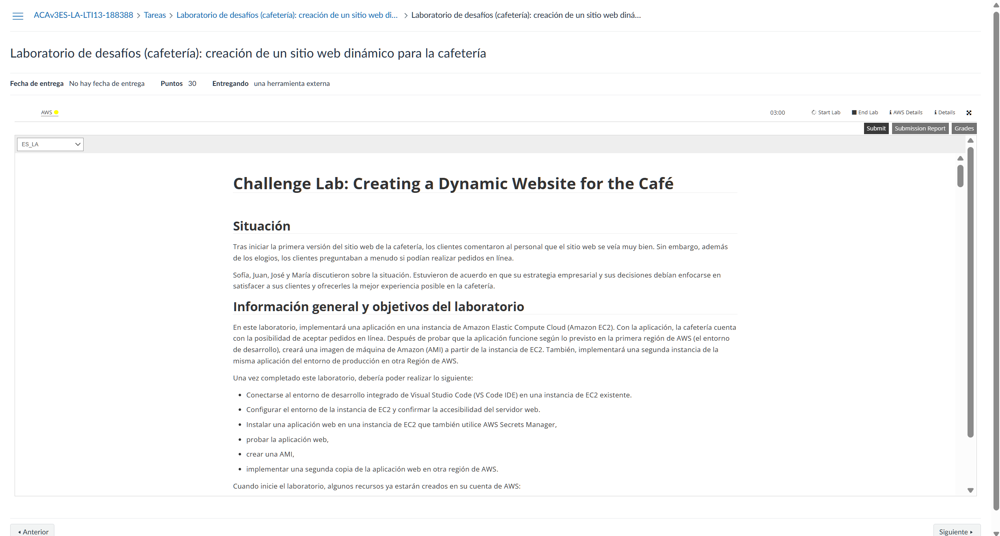

3. Espera con paciencia hasta que el círculo junto a **AWS** cambie a **verde**.

**✅ Cómo saber que vas bien:** El punto junto a **AWS** está en **verde fijo** y el temporizador superior muestra el tiempo restante de tu sesión (unas 3 horas de margen, más que suficiente para completar el laboratorio en 45–60 minutos).

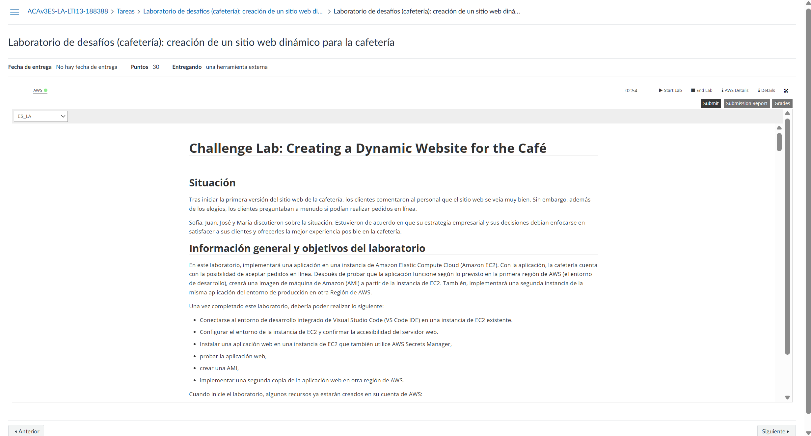

> **⚠️ Error típico:** Si intentas pulsar sobre **AWS** mientras el círculo sigue en amarillo o rojo, no te dejará entrar a la consola. Espera siempre al verde. Si más adelante el temporizador se acercara a `00:00`, puedes volver a pulsar **Start Lab** para renovar el tiempo sin perder tu trabajo.

---

### Paso 2: Abrir `AWS Details` y guardar las credenciales del IDE
1. En la barra superior derecha, haz clic en **AWS Details**.
2. Se desplegará un panel lateral derecho llamado **Cloud Access**. Localiza las tres últimas filas del panel:
   * **`LabIDEURL`**: la dirección web donde se abre tu Visual Studio Code en la nube.
   * **`LabIDEPassword`**: la contraseña que te pedirá para entrar.
   * **`MCQURL`**: el enlace azul `Access the multiple choice questions` (el test evaluable del laboratorio).
3. Copia **`LabIDEURL`** y **`LabIDEPassword`** en tu hoja de apuntes (los usaremos dentro de un momento en la Tarea 2).

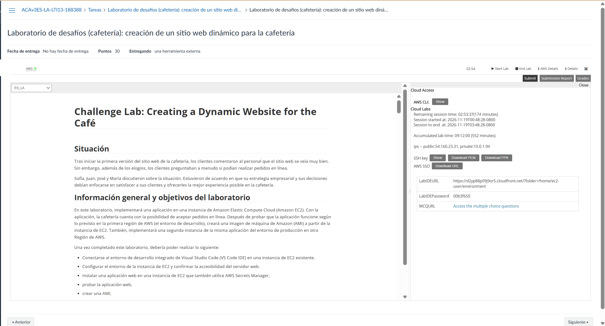

---

### Paso 3: Abrir el cuestionario de evaluación (y dejarlo abierto)
1. Dentro de ese mismo panel **AWS Details**, haz clic sobre el enlace azul **`Access the multiple choice questions`**.
2. Se abrirá una pestaña nueva con las **7 preguntas** del laboratorio.
3. **No marques nada todavía** y **no cierres esta pestaña**: la dejaremos abierta en segundo plano para ir contestando las Preguntas 1–4 en la Tarea 1.1 y las Preguntas 5–7 en la Tarea 6 conforme comprobemos cada dato en la consola.

**✅ Cómo saber que vas bien:** Ves la página titulada *AWS Academy Cloud Architecting - Módulo 4: Preguntas del laboratorio de desafíos* (o su versión en inglés) con las cajas numeradas de la Pregunta 1 a la 7 y un botón gris **`enviar` / `Submit`** dentro de cada caja.

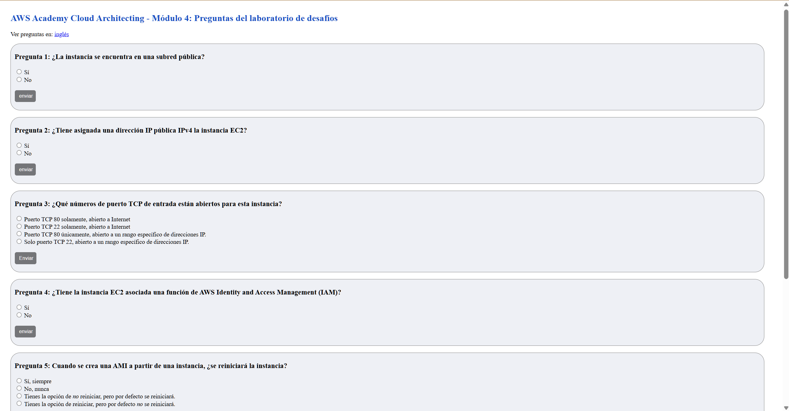

> **⚠️ Ojo aquí:** Fíjate en que arriba aparece el enlace *Ver preguntas en: inglés* (o *Spanish*). Puedes leerlas en el idioma que prefieras; los botones de respuesta funcionan exactamente igual.

---

### Paso 4: Abrir la Consola de administración de AWS
1. Vuelve a la pestaña de instrucciones del laboratorio de AWS Academy.
2. Haz clic directamente sobre el enlace **`AWS`** (al lado del punto verde, arriba a la izquierda).
3. Se abrirá la **Consola de administración de AWS** en una pestaña nueva.

**✅ Cómo saber que vas bien:** Has entrado a la consola de AWS y, en la esquina superior derecha, aparece seleccionada la región **Estados Unidos (Norte de Virginia)** (`us-east-1`).

> **⚠️ Error típico (ventanas emergentes bloqueadas):** Si al hacer clic en `AWS` no se abre ninguna pestaña nueva, mira la barra de direcciones de tu navegador (arriba a la derecha): verás un icono de ventana emergente bloqueada. Haz clic en él, selecciona **Permitir ventanas emergentes** y vuelve a pulsar `AWS`.

[⬆️ Volver al índice](#inicio)

---

<a id="desafio-1"></a>
## 1. Desafío 1: Preparar una instancia EC2 para alojar un sitio web

**Contexto empresarial:** La cafetería tiene actualmente una web estática en Amazon S3, pero quiere aceptar pedidos en línea y guardarlos en una base de datos. Asumes el rol de Sofía para preparar un servidor web dinámico en **Amazon EC2**.

---

<a id="tarea-1"></a>
### Tarea 1: Analizar la instancia `Lab IDE` existente

Antes de instalar nada, el laboratorio te pide investigar una instancia EC2 que ya viene creada por defecto llamada **`Lab IDE`**. Con lo que observes en 4 clics responderemos con total seguridad las **Preguntas 1 a 4** del cuestionario.

#### Paso 1: Entrar en Amazon EC2 y seleccionar `Lab IDE`
1. En la barra de búsqueda superior de la Consola de AWS, escribe **`EC2`** y haz clic sobre el servicio **EC2** (*Servidores virtuales en la nube*).

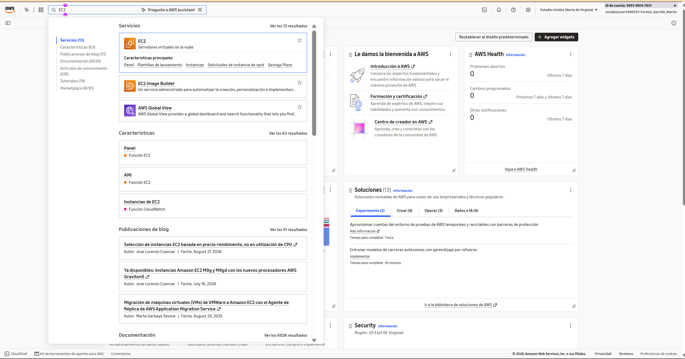

2. En el menú lateral izquierdo, haz clic en **Instancias** (*Instances*).
3. Verás una única instancia en estado verde **En ejecución** (*Running*) llamada **`Lab IDE`**.
4. Haz clic en la **casilla de verificación** a la izquierda de `Lab IDE` para que se despliegue el panel inferior con todas sus pestañas (*Detalles*, *Seguridad*, *Redes*, etc.).

---

#### Paso 2: Revisar la pestaña `Detalles` (Para Preguntas 1, 2 y 4)
Con `Lab IDE` marcada, asegúrate de estar en la pestaña inferior **Detalles** (*Details*) y fíjate en tres datos concretos:

1. **Dirección IPv4 pública:** Comprueba que tiene una IP asignada (en nuestro caso: `54.160.23.31`). **Anótala en tu hoja de apuntes**, porque la usaremos para abrir la web de la cafetería desde el navegador. → *(Esto responde la **Pregunta 2**: **Sí**)*.
2. **ID de subred:** Fíjate en el texto entre paréntesis al lado del ID (`IDE Public Subnet One`). → *(Ya nos da la pista para la **Pregunta 1**, pero vamos a confirmarlo en el Paso 3)*.
3. **Rol de IAM:** Mira la columna derecha, debajo de *Dirección IP asignada automáticamente*. Verás que **sí** hay un rol asignado cuyo nombre contiene **`VSCodeInstanceRole`** (por ejemplo, `...VSCodeInstanceRole-...`). → *(Esto responde la **Pregunta 4**: **Sí**)*.

**✅ Cómo saber que vas bien:** Tu panel inferior de **Detalles** muestra la IPv4 pública, el ID de subred `IDE Public Subnet One` y un Rol de IAM con `VSCodeInstanceRole` en el nombre.

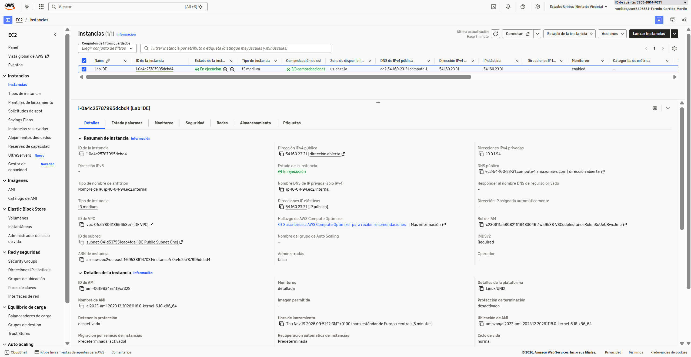

> **⚠️ Error típico en la Pregunta 4:** Mucha gente recuerda versiones antiguas de este laboratorio (cuando usaba AWS Cloud9) o lee las pistas del Desafío 2 y marca «No» en la Pregunta 4. **¡Cuidado!** Al iniciar el laboratorio, `Lab IDE` **SÍ tiene** un rol de IAM asociado (`VSCodeInstanceRole`). Lo que ocurre más adelante (en la Tarea 4) es que un script se lo quitará a propósito para crear el Desafío 2. En este momento, la respuesta correcta es **Sí**.

---

#### Paso 3: Confirmar que la subred es pública (Para Pregunta 1)
1. En esa misma pestaña **Detalles**, haz clic directamente sobre el enlace azul del **ID de subred** (`subnet-... (IDE Public Subnet One)`).
2. Se abrirá la pantalla de **VPC > Subredes** filtrada por esa subred.
3. Revisa su nombre (**`IDE Public Subnet One`**) y, en el panel inferior de detalles, verifica el campo **Asignación automática de la dirección IPv4 pública: `Sí`**.

**✅ Cómo saber que vas bien:** Confirmas al 100 % que la instancia está alojada en una **subred pública** (`IDE Public Subnet One`). → *(Esto responde la **Pregunta 1**: **Sí**)*.

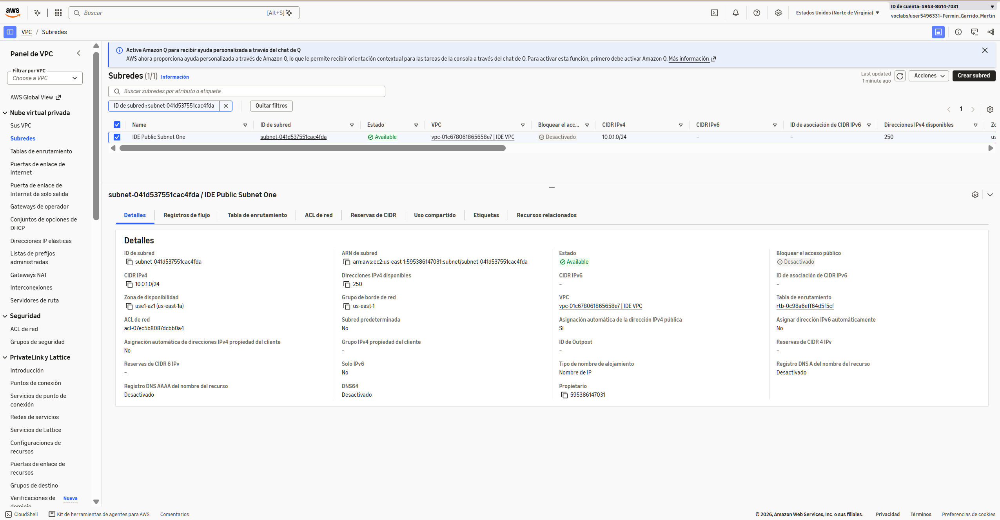

---

#### Paso 4: Revisar la pestaña `Seguridad` y los puertos de entrada (Para Pregunta 3)
1. Vuelve a **EC2 > Instancias** (puedes usar el botón Atrás del navegador o el buscador) y selecciona de nuevo la casilla de **`Lab IDE`**.
2. Haz clic en la pestaña inferior **Seguridad** (*Security*).
3. Desplázate hacia abajo hasta la tabla **Reglas de entrada** (*Inbound rules*) y lee con mucha atención las 4 columnas:
   * **Intervalo de puertos:** `80`
   * **Protocolo:** `TCP`
   * **Origen:** `pl-3b927c52` *(no pone `0.0.0.0/0`)*
   * **Descripción:** `Allow HTTP from com.amazonaws.global.cloudfront.origin-facing`

**✅ Cómo saber que vas bien:** Ves una única regla de entrada en el grupo `Lab IDE SG` para el puerto **TCP 80**, y su origen es una lista de prefijos (`pl-...`), **no** `0.0.0.0/0`.

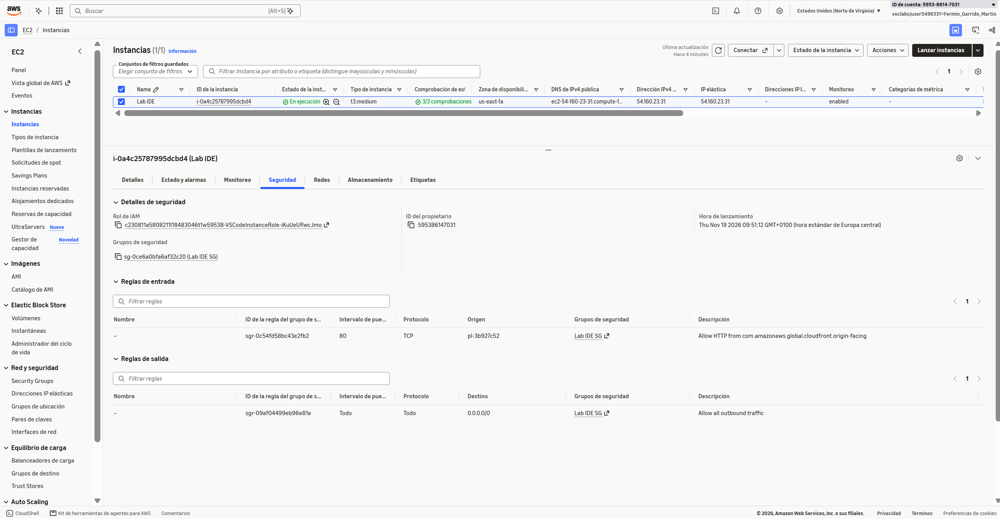

> **⚠️ Trampa clásica en la Pregunta 3 (¡la que más falla la gente!):**  
> Como el puerto abierto es el `80` (HTTP), es muy tentador marcar *"Puerto TCP 80 solamente, abierto a Internet"*. **¡Incorrecto!**  
> Fíjate en la columna **Origen**: no pone `0.0.0.0/0` (todo Internet), sino `pl-3b927c52`, que es una **lista de prefijos con un rango específico de direcciones IP** pertenecientes a Amazon CloudFront (porque tu navegador accede a VS Code a través de una URL `*.cloudfront.net`). Por tanto, la opción correcta es **Puerto TCP 80 únicamente, abierto a un rango específico de direcciones IP**.

---

<a id="tarea-1-1"></a>
### Tarea 1.1: Responder las Preguntas 1 a 4 del cuestionario

1. Cambia a la pestaña del navegador donde dejaste abierto el cuestionario (**Multiple Choice Questions**).
2. Marca exactamente estas opciones para las 4 primeras preguntas:

| Nº | Pregunta | Opción correcta (Español) | Opción correcta (Inglés) |
| :--- | :--- | :--- | :--- |
| **1** | ¿La instancia se encuentra en una subred pública? | **Sí** | **Yes** |
| **2** | ¿Tiene asignada una dirección IP pública IPv4 la instancia EC2? | **Sí** | **Yes** |
| **3** | ¿Qué números de puerto TCP de entrada están abiertos para esta instancia? | **Puerto TCP 80 únicamente, abierto a un rango específico de direcciones IP.** | **TCP port 80 only, open to a specific range of IP addresses** |
| **4** | ¿Tiene la instancia EC2 asociada una función de AWS IAM? | **Sí** | **Yes** |

3. **¡MUY IMPORTANTE!** Haz clic en el botón gris **`enviar` / `Submit`** debajo de **CADA UNA** de las 4 preguntas (uno por pregunta).

**✅ Cómo saber que vas bien:** Las 4 casillas quedan marcadas y has pulsado los 4 botones grises de envío individuales. Deja la pestaña abierta porque en la Tarea 6 volveremos a por las preguntas 5, 6 y 7.

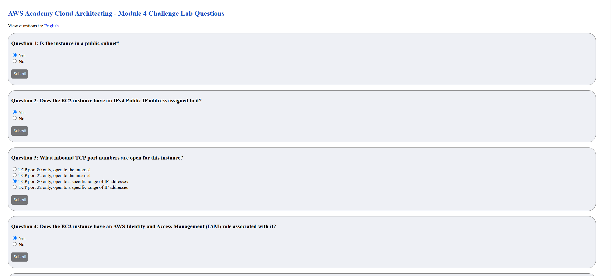

> **⚠️ Error típico:** Seleccionar los círculos azules pero olvidarse de pulsar el botón `Submit` / `enviar` de debajo de cada pregunta. Si no lo pulsas en cada una, AWS Academy te puntuará esas preguntas con `0/1` al final aunque las tengas marcadas en pantalla.

[⬆️ Volver al índice](#inicio)

---

<a id="tarea-2"></a>
### Tarea 2: Conectarse al IDE de VS Code en la instancia EC2

En lugar de usar PuTTY o una terminal SSH externa, este laboratorio trae un **Visual Studio Code (`code-server`)** ejecutándose dentro de la propia instancia `Lab IDE` accesible desde el navegador.

#### Paso 1: Abrir la URL de VS Code e iniciar sesión
1. Recupera de tu hoja de apuntes los valores **`LabIDEURL`** y **`LabIDEPassword`** que copiaste de `AWS Details` en la Fase Previa.
2. Abre una pestaña nueva en tu navegador, pega tu **`LabIDEURL`** en la barra de direcciones y pulsa **Intro**.
3. Aparecerá una pantalla blanca con el título **Welcome to code-server** pidiendo contraseña.

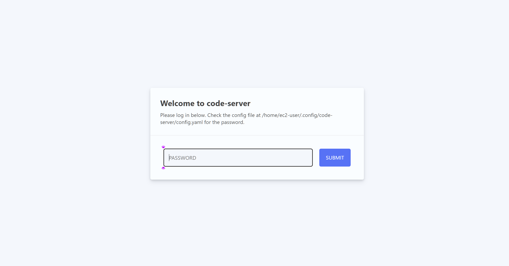

4. Pega tu **`LabIDEPassword`** dentro de la caja `PASSWORD` y haz clic en el botón azul **SUBMIT**.

#### Paso 2: Comprobar que tienes el explorador y la terminal Bash listos
Tras unos segundos cargará la interfaz completa de **VS Code en el navegador**. Identifica sus tres zonas:
* **Panel izquierdo (`EXPLORER`):** muestra tu carpeta de trabajo `ENVIRONMENT` (`/home/ec2-user/environment`). Al principio está vacía; iremos creando enlaces y descargando archivos dentro.
* **Panel central/superior:** el editor donde abriremos archivos HTML, PHP y scripts `.sh`.
* **Panel inferior (`TERMINAL`):** una consola Bash conectada directamente a tu instancia EC2 como usuario `ec2-user`.

**✅ Cómo saber que vas bien:** Ves el entorno de VS Code cargado y en la parte inferior aparece el prompt de la terminal listo para escribir comandos (similar a `[ec2-user@ip-10-0-1-94 environment]$`).

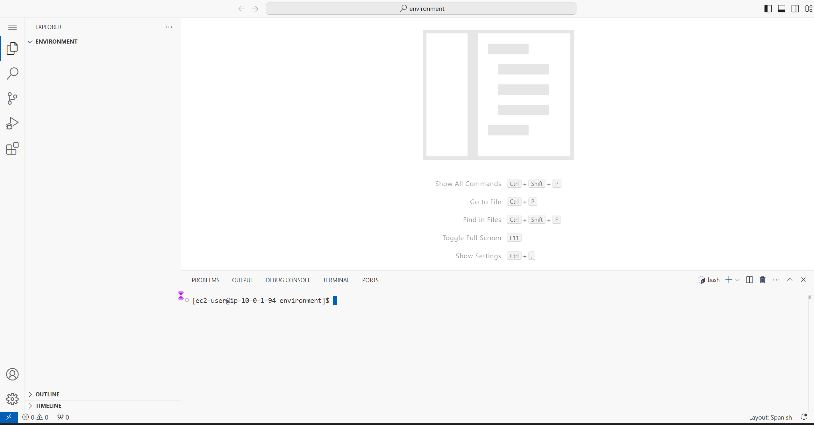

> **⚠️ Error típico (si no ves la terminal abajo):** Si al entrar el panel inferior de la terminal estuviera cerrado, puedes abrirlo en cualquier momento haciendo clic en el icono de las tres rayas (`☰`) arriba a la izquierda → **`Terminal` > `New Terminal`**.  
> **Truco para pegar comandos en VS Code web:** Si `Ctrl + V` no pega dentro de la terminal del navegador, usa **`Ctrl + Shift + V`** o haz **clic derecho > Paste** (y acepta el permiso de portapapeles del navegador si te lo pide).

[⬆️ Volver al índice](#inicio)


---

<a id="tarea-3"></a>
### Tarea 3: Configurar la pila LAMP y resolver el Desafío 1 (Puerto 8000)

**Qué vamos a conseguir en esta tarea:**  
Vamos a montar la base de nuestra pila **LAMP** (*Linux + Apache + MariaDB + PHP*) dentro de la instancia `Lab IDE`, crear una página web de prueba (`index.html`) y enfrentarnos al **Desafío 1**: descubrir por qué nadie puede entrar desde Internet al servidor web y solucionarlo en la consola de AWS.

> **💡 Por qué usamos el puerto `8000` en lugar del puerto `80`:**  
> Normalmente un servidor web Apache escucha en el puerto estándar `80`. Sin embargo, en esta instancia el puerto `80` **ya está ocupado por tu VS Code (`code-server`)**. Si arrancáramos Apache en el `80`, chocarían y uno de los dos fallaría. Por eso vamos a mover Apache al puerto **`8000`**.

---

#### Paso 1: Comprobar el sistema operativo, mover Apache al puerto `8000` y verificar PHP
En la terminal Bash inferior de tu VS Code, copia y pega este primer comando para ver qué distribución de Linux ejecuta la instancia:

```bash
cat /proc/version
```

Ahora ejecuta este bloque para cambiar la configuración de Apache al puerto `8000`, iniciar el servicio, dejarlo habilitado para que arranque solo si se reinicia la máquina y comprobar su estado:

```bash
sudo sed -i 's/Listen 80/Listen 8000/g' /etc/httpd/conf/httpd.conf
sudo systemctl start httpd
sudo systemctl enable httpd
sudo service httpd status
```

> **⚠️ Ojo aquí (terminal pausada):**  
> El comando `sudo service httpd status` suele abrir un visor de texto que deja la terminal pausada mostrando el estado del servicio (a veces con el mensaje `lines 1-... (END)`). Si ves que no te devuelve el cursor normal `[ec2-user@...]$`, **pulsa la tecla `q`** para salir.

Una vez de vuelta en el prompt, comprueba que PHP ya viene preinstalado ejecutando:

```bash
php --version
```

**✅ Cómo saber que vas bien:**
* `cat /proc/version` indica que estás en **Amazon Linux 2023** (`amzn2023`).
* En el estado de `httpd.service` aparece en verde **`active (running)`** y la línea **`Status: "Started, listening on: port 8000"`**.
* `php --version` devuelve la versión instalada (por ejemplo, **PHP 8.5.12**).

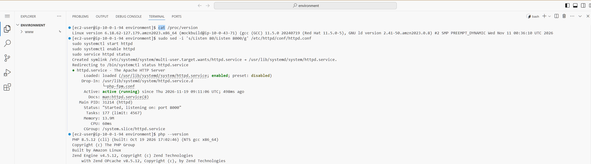

---

#### Paso 2: Instalar y arrancar la base de datos MariaDB
El servidor web y PHP ya funcionan, pero todavía nos falta el motor de base de datos relacional donde se guardarán el menú y los pedidos. Ejecuta este bloque en la terminal Bash para instalar **MariaDB 10.5**, iniciarlo y activarlo en el arranque automático:

```bash
sudo dnf install -y mariadb105-server
sudo systemctl start mariadb
sudo systemctl enable mariadb
sudo mariadb --version
sudo service mariadb status
```

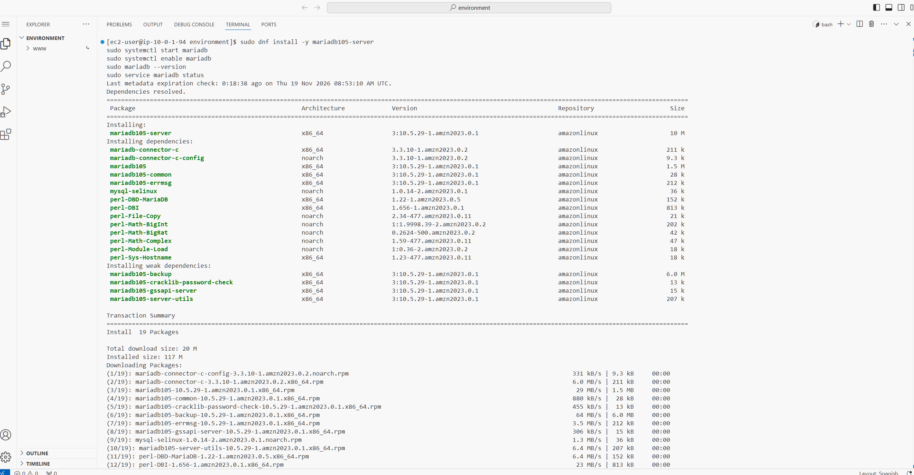

> **⚠️ Error típico:** Igual que con Apache, al ejecutar `sudo service mariadb status` la terminal se quedará retenida mostrando el registro del servicio y verás `lines 1-23/23 (END)` en la parte inferior. **Pulsa la tecla `q`** para cerrar esa vista y volver a escribir comandos.

**✅ Cómo saber que vas bien:** Antes de pulsar `q`, comprueba que `mariadb.service` muestra en verde **`active (running)`** y la línea **`Status: "Taking your SQL requests now..."`**.

---

#### Paso 3: Conectar `/var/www` con el explorador de archivos de VS Code
Por defecto, el explorador izquierdo de VS Code solo muestra `/home/ec2-user/environment`, pero Apache sirve las páginas web desde `/var/www/html` (y además esa carpeta pertenece al usuario `root`, así que no podríamos guardar archivos ahí desde el editor).

Ejecuta estos dos comandos para crear un acceso directo (enlace simbólico) dentro de tu espacio de trabajo y darte permisos de propietario sobre `html`:

```bash
ln -s /var/www/ /home/ec2-user/environment
sudo chown ec2-user:ec2-user /var/www/html
```

**✅ Cómo saber que vas bien:** Los comandos terminan sin errores y, si miras el panel izquierdo **`EXPLORER`** de VS Code, verás que acaba de aparecer la carpeta **`www`** (con una pequeña flecha a la derecha indicando que es un enlace simbólico).

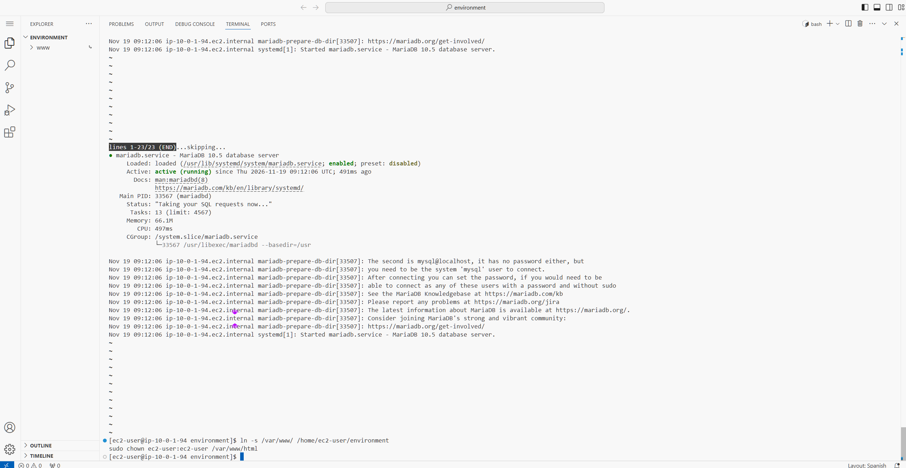

---

#### Paso 4: Crear una página web de prueba (`index.html`)
Antes de instalar la aplicación real de la cafetería, vamos a crear una página HTML mínima para comprobar que Apache responde bien.

1. En el panel izquierdo **`EXPLORER`** de VS Code, haz clic para desplegar **`ENVIRONMENT` > `www`**.
2. Haz clic sobre la carpeta **`html`** para seleccionarla.
3. Crea un archivo nuevo dentro de `html` (clic derecho sobre `html` > **New File...**, o menú `☰ > File > New File`).
4. Escribe el nombre exacto **`index.html`** y pulsa **Intro**.
5. En el editor que se abre a la derecha, pega exactamente esta línea:

```html
<html>Hello from the café web server!</html>
```

6. **Guarda el archivo** pulsando **`Ctrl + S`** (o desde el menú `☰ > File > Save`).

**✅ Cómo saber que vas bien:** En la barra superior del editor aparece la pestaña `index.html` con una **`x`** al lado (si ves un **punto blanco o negro** en lugar de la `x`, significa que todavía no lo has guardado: pulsa `Ctrl + S`). En el panel izquierdo debe verse `www > html > index.html`.

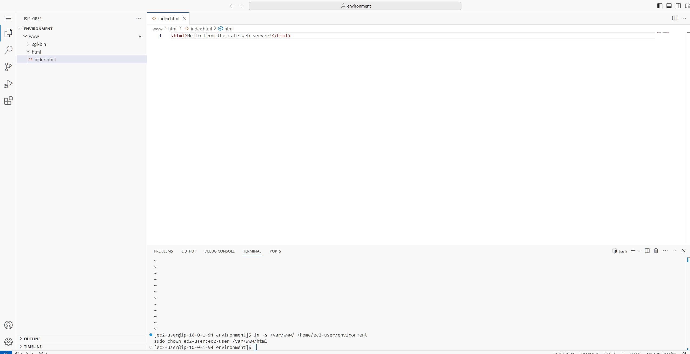

> **⚠️ Error típico:** Crear `index.html` por descuido en la raíz de `ENVIRONMENT` o dentro de `www` en vez de dentro de **`www/html`**. Si no está exactamente dentro de `html`, Apache no lo encontrará.

---

#### Paso 5: Resolver el Desafío 1 — Permitir el acceso web desde Internet (Puerto 8000)

##### 5.1. Comprobar el problema primero
1. Abre una pestaña nueva en tu navegador.
2. Escribe la dirección de tu servidor usando **tu IPv4 pública de Desarrollo (Virginia)** de tu hoja de apuntes seguida de `:8000`:
   ```text
   http://<TU-IP-PUBLICA-VIRGINIA>:8000
   ```
   *(Ejemplo de nuestra sesión: `http://54.160.23.31:8000`)*

3. Verás que la pestaña se queda pensando unos segundos y finalmente falla con **`No se puede acceder a este sitio web — ERR_CONNECTION_TIMED_OUT`**.

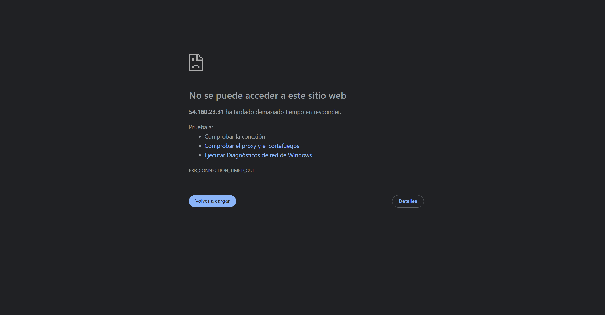

**¿Por qué falla?**  
Apache está encendido y escuchando en el puerto `8000` (lo comprobamos en el Paso 1), pero el firewall virtual de la instancia (**Grupo de Seguridad `Lab IDE SG`**) solo tiene abierto el puerto `80` para CloudFront. Todo tráfico que intenta entrar por el puerto `8000` es bloqueado silenciosamente.

##### 5.2. Abrir el puerto TCP `8000` en el Grupo de Seguridad
1. Ve a la pestaña de la **Consola de AWS** (región **Norte de Virginia**) > **EC2** > **Instancias**.
2. Marca la casilla de **`Lab IDE`** y abre la pestaña inferior **Seguridad** (*Security*).
3. Haz clic en el enlace azul del grupo de seguridad **`Lab IDE SG`** (`sg-...`).
4. En la pestaña inferior **Reglas de entrada** (*Inbound rules*), pulsa el botón **Editar reglas de entrada** (*Edit inbound rules*).
5. Haz clic en **Agregar regla** (*Add rule*) —**no borres la regla existente del puerto 80** o perderás la conexión con VS Code— y rellena la nueva fila exactamente así:
   * **Tipo:** `TCP personalizado` (*Custom TCP*)
   * **Intervalo de puertos:** `8000`
   * **Tipo de origen:** `Anywhere-IPv4` *(se rellenará automáticamente con `0.0.0.0/0`)*
   * **Descripción (opcional):** `Permitir HTTP puerto 8000 para la cafeteria`

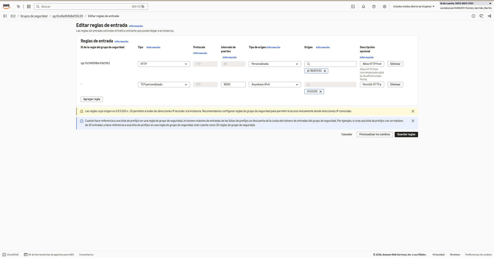

6. Pulsa el botón negro **Guardar reglas** (*Save rules*).

##### 5.3. Verificar que ya es accesible desde Internet
1. Regresa a la pestaña del navegador donde te había dado el error de tiempo de espera y **recarga la página (`F5`)** en `http://<TU-IP-PUBLICA-VIRGINIA>:8000`.

**✅ Cómo saber que vas bien:** La página carga al instante mostrando el texto **`Hello from the café web server!`**. ¡Desafío 1 superado! (Esto vale **5/5 puntos** en la evaluación final: `[Task 3] Web server SG config`).


> **⚠️ Dos errores típicos al probar la URL en el navegador:**
> * **Usar `https://` por error:** Algunos navegadores autocompletan `https://` en lugar de `http://`. Como no hemos configurado certificado SSL en Apache, `https://...:8000` fallará siempre. Escribe explícitamente **`http://`**.
> * **Olvidar el `:8000` al final:** Si pones solo la IP sin `:8000`, el navegador intentará entrar al puerto `80`, que solo acepta tráfico desde CloudFront y volverá a darte timeout.

[⬆️ Volver al índice](#inicio)


---

<a id="desafio-2"></a>
## 2. Desafío 2: Instalar la aplicación web dinámica de la cafetería

**Contexto empresarial:** Ya tienes un servidor web Apache accesible por el puerto `8000`, PHP funcionando y el motor MariaDB encendido. Ahora toca desplegar el código real de la cafetería, guardar las credenciales de forma segura en **AWS Secrets Manager**, crear las tablas de la base de datos y resolver el **Desafío 2**: descubrir por qué la portada de la web carga pero el menú sale vacío.

---

<a id="tarea-4"></a>
### Tarea 4: Desplegar la web, Secrets Manager, MariaDB y resolver el Desafío 2 (Rol IAM)

#### Paso 1: Descargar y extraer la aplicación de la cafetería y el AWS SDK para PHP
En la terminal Bash de tu VS Code, ejecuta este bloque de comandos para descargar los archivos de configuración (`setup.zip`), base de datos (`db.zip`), la aplicación web (`cafe.zip`) y el SDK oficial de AWS para PHP, descomprimir cada uno en su sitio y dar permisos de lectura a Apache:

```bash
cd ~/environment
wget [https://aws-tc-largeobjects.s3.us-west-2.amazonaws.com/CUR-TF-200-ACACAD-3-113230/03-lab-mod5-challenge-EC2/s3/setup.zip](https://aws-tc-largeobjects.s3.us-west-2.amazonaws.com/CUR-TF-200-ACACAD-3-113230/03-lab-mod5-challenge-EC2/s3/setup.zip)
unzip setup.zip
wget [https://aws-tc-largeobjects.s3.us-west-2.amazonaws.com/CUR-TF-200-ACACAD-3-113230/03-lab-mod5-challenge-EC2/s3/db.zip](https://aws-tc-largeobjects.s3.us-west-2.amazonaws.com/CUR-TF-200-ACACAD-3-113230/03-lab-mod5-challenge-EC2/s3/db.zip)
unzip db.zip
wget [https://aws-tc-largeobjects.s3.us-west-2.amazonaws.com/CUR-TF-200-ACACAD-3-113230/03-lab-mod5-challenge-EC2/s3/cafe.zip](https://aws-tc-largeobjects.s3.us-west-2.amazonaws.com/CUR-TF-200-ACACAD-3-113230/03-lab-mod5-challenge-EC2/s3/cafe.zip)
unzip cafe.zip -d /var/www/html/
cd /var/www/html/cafe/
wget [https://docs.aws.amazon.com/aws-sdk-php/v3/download/aws.zip](https://docs.aws.amazon.com/aws-sdk-php/v3/download/aws.zip)
wget [https://docs.aws.amazon.com/aws-sdk-php/v3/download/aws.phar](https://docs.aws.amazon.com/aws-sdk-php/v3/download/aws.phar)
unzip aws -d /var/www/html/cafe/
chmod -R +r /var/www/html/cafe/
```

Cuando termine de descomprimir, inspecciona cómo está programada la aplicación:
1. En el panel izquierdo (**`EXPLORER`**) de VS Code, despliega **`www > html > cafe`**.
2. Haz doble clic sobre **`getAppParameters.php`** para abrirlo en el editor.
3. Fíjate en dos detalles clave del código:
   * En la **línea 3** carga el SDK de AWS (`require 'aws.phar';`).
   * Más abajo (líneas 34–39) detecta automáticamente la región de la instancia mediante los metadatos de EC2 (`169.254.169.254`) y crea un cliente **`SecretsManagerClient`** para leer 7 parámetros desde **AWS Secrets Manager**.

> **💡 Por qué se diseña así en arquitectura cloud:**  
> En lugar de escribir el usuario y la contraseña de MySQL a fuego dentro del código PHP (lo cual sería un grave fallo de seguridad si alguien accede al repositorio), la aplicación consulta los secretos en tiempo real a **AWS Secrets Manager**.

**✅ Cómo saber que vas bien:** En el explorador izquierdo de VS Code aparecen las carpetas `db`, `setup` y, dentro de `www/html/cafe/`, todos los archivos PHP (`index.php`, `menu.php`, `getAppParameters.php`, `aws.phar`, etc.), y la terminal termina sin errores en `[ec2-user@... cafe]$`.

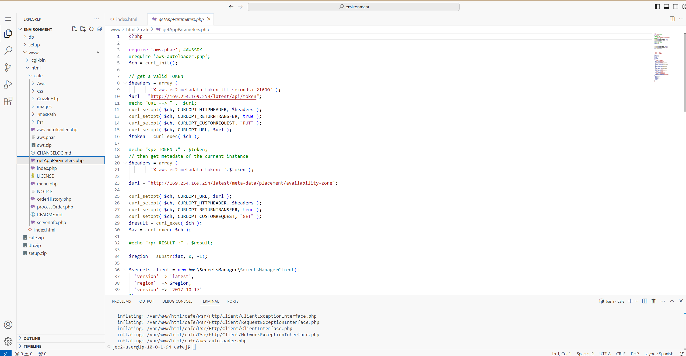

---

#### Paso 2: Crear los 7 secretos en AWS Secrets Manager y copiar la contraseña de la BD
1. En la terminal Bash de VS Code, entra en la carpeta `setup` y ejecuta el script que crea automáticamente los 7 parámetros en **Secrets Manager** (región `us-east-1`):

```bash
cd ~/environment/setup/
./set-app-parameters.sh
```

> **💡 Lo que acaba de hacer el script «por detrás» (pista clave del Desafío 2):**  
> Además de crear los 7 secretos en Secrets Manager, la última línea de este script ejecuta deliberadamente una orden para **desasociar el rol de IAM** que traía `Lab IDE` (`"State": "disassociating"` sobre `VSCodeInstanceProfile`). Deja tu instancia EC2 **sin ningún rol de IAM** para provocar el fallo que diagnosticaremos en el Paso 5.

2. Ahora ve a la pestaña de la **Consola de AWS** (región **Norte de Virginia**), escribe **`Secrets Manager`** en la barra de búsqueda superior y entra en el servicio.

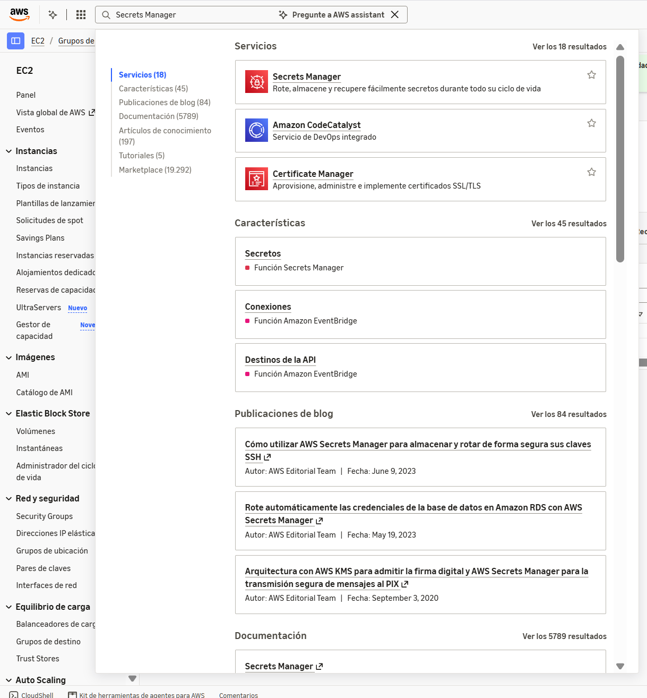

3. En el menú lateral izquierdo, haz clic en **Secretos** (*Secrets*).
4. Comprueba que aparecen los **7 secretos** creados por el script:
   * `/cafe/dbPassword`
   * `/cafe/dbUser`
   * `/cafe/dbName`
   * `/cafe/dbUrl`
   * `/cafe/currency`
   * `/cafe/timeZone`
   * `/cafe/showServerInfo`

> **⚠️ Ojo aquí:** Si al entrar ves la lista vacía o faltan secretos, espera 15–20 segundos y pulsa el icono circular de **Actualizar** arriba a la derecha.

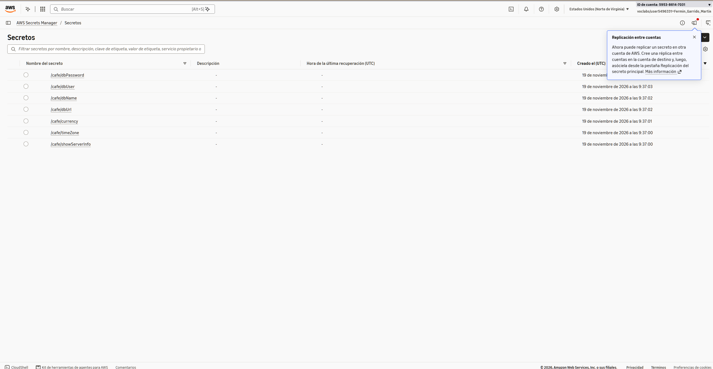

5. Haz clic sobre el nombre **`/cafe/dbPassword`**.
6. Desplázate hasta la sección **Valor del secreto** y pulsa el botón **Recuperar valor del secreto** (*Retrieve secret value*).
7. Copia la contraseña que se muestra en texto plano (**`Lab123#`**) y anótala en tu **Hoja de Apuntes**.

**✅ Cómo saber que vas bien:** Ves los 7 secretos `/cafe/*` listados en Norte de Virginia y has recuperado el valor **`Lab123#`** de `/cafe/dbPassword`.

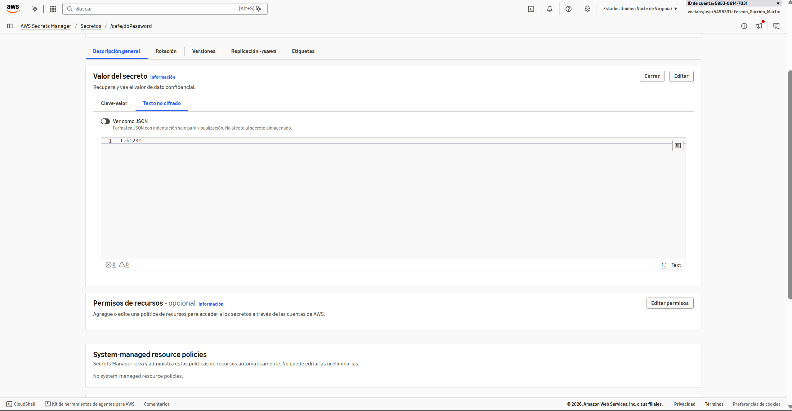

---

#### Paso 3: Crear la base de datos `cafe_db` en MariaDB y verificar los productos
1. Regresa a la terminal Bash de VS Code y ejecuta los dos scripts de la carpeta `db` para configurar la contraseña de administración y crear la base de datos junto con sus tablas y datos iniciales:

```bash
cd ~/environment/db/
./set-root-password.sh
./create-db.sh
```

2. Conéctate ahora al cliente de MySQL/MariaDB como usuario `admin`:

```bash
mysql -u admin -p
```

3. Cuando la terminal te muestre `Enter password:`, pega la contraseña copiada de Secrets Manager (**`Lab123#`**) y pulsa **Intro**.

> **⚠️ Error típico con contraseñas en Linux:** Al escribir o pegar `Lab123#` en `Enter password:`, **no aparecerá ningún carácter ni asterisco** en pantalla por seguridad. Es totalmente normal: pégala una sola vez y pulsa **Intro**.

**✅ Cómo saber que vas bien:** Tras la ejecución de los scripts ves `Set admin Password script completed.` y `Create Database script completed.`, y al introducir la contraseña aparece el saludo `Welcome to the MariaDB monitor.` junto al prompt **`MariaDB [(none)]>`**.

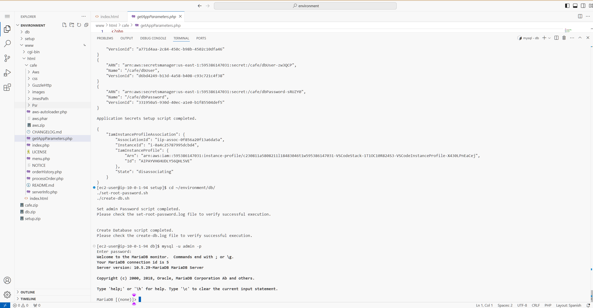

4. Dentro del prompt `MariaDB [(none)]>`, pega y ejecuta estas consultas SQL para inspeccionar la base de datos `cafe_db`, sus 4 tablas (`order`, `order_item`, `product`, `product_group`) y el catálogo de 9 productos precargados:

```sql
show databases;
use cafe_db;
show tables;
select * from product;
exit;
```

**✅ Cómo saber que vas bien:** La tabla `product` devuelve **`9 rows in set`** (desde `1 | Croissant | 1.50` hasta `9 | Latte | 3.50`).

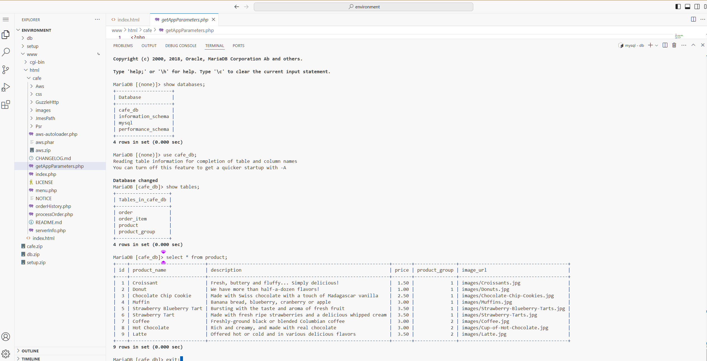

> **⚠️ ¡ERROR MUY COMÚN AQUÍ! Comprueba que has salido de MariaDB:**  
> Al pegar el bloque anterior de varias líneas, es muy habitual que el cursor se quede parado justo al final de **`MariaDB [cafe_db]> exit;`** sin haberse ejecutado esa última línea.  
> **Pulsa la tecla `Intro` una vez más** hasta que aparezca **`Bye`** y vuelvas a ver el prompt normal de Linux (**`[ec2-user@ip-10-0-1-94 db]$`**). Si intentas ejecutar los comandos del Paso 4 mientras sigues dentro de `MariaDB>`, te dará errores de sintaxis SQL.

---

#### Paso 4: Configurar la zona horaria en PHP, reiniciar Apache y abrir la web
1. **Ya de vuelta en tu terminal Bash normal** (`[ec2-user@...]$`), actualiza la zona horaria en `/etc/php.ini` y reinicia Apache para aplicar el cambio:

```bash
sudo sed -i "2i date.timezone = \"America/New_York\" " /etc/php.ini
sudo service httpd restart
```

2. Abre una nueva pestaña en el navegador y accede a tu aplicación usando tu IPv4 pública de Desarrollo seguida de `:8000/cafe`:
   ```text
   http://<TU-IP-PUBLICA-VIRGINIA>:8000/cafe
   ```
   *(Ejemplo de nuestra sesión: `http://54.160.23.31:8000/cafe`)*

3. **¡No te dejes engañar por la portada!** Verás que la página de inicio (**Home**) carga aparentemente perfecta, con el logo *Café*, la barra naranja y las fotografías de bollería y café:

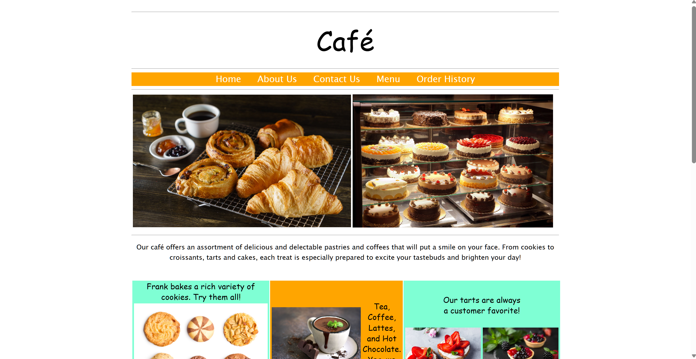

---

#### Paso 5: Resolver el Desafío 2 — Diagnosticar el fallo del Menú y asociar `CafeRole`

##### 5.1. Provocar y entender el fallo real
1. En esa misma web de la cafetería, haz clic en la pestaña **`Menu`** de la barra naranja superior.
2. Verás que **debajo de la barra naranja la página aparece completamente en blanco**: no carga ni un solo producto ni precio.

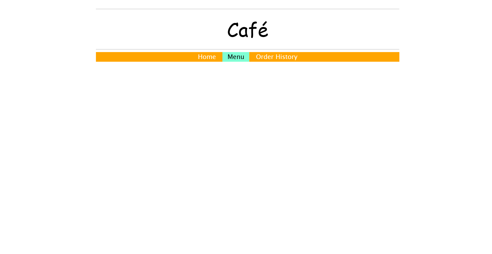

**¿Por qué la portada (`Home`) sí funcionaba pero `Menu` sale en blanco?**
* La portada muestra contenido HTML e imágenes estáticas servidas directamente por Apache (no necesita conectarse a MySQL).
* La pestaña **`Menu`** (`menu.php`) necesita leer los 9 productos de MariaDB. Para conectarse a la base de datos, llama a `getAppParameters.php` para pedirle el usuario y la contraseña a **AWS Secrets Manager**.
* Como el script del Paso 2 le quitó el rol de IAM a `Lab IDE`, la instancia **no tiene credenciales ni permisos de IAM** para llamar a Secrets Manager, la petición falla silenciosamente y no puede conectar a la base de datos.

##### 5.2. Inspeccionar el rol `CafeRole` en AWS IAM
1. Ve a la pestaña de la **Consola de AWS**, busca **`IAM`** en la barra superior y entra al servicio.
2. En el menú lateral izquierdo, haz clic en **Roles**.
3. Escribe **`CafeRole`** en el buscador de roles y haz clic sobre **`CafeRole`** para abrirlo.
4. En la pestaña **Permisos** verás dos políticas personalizadas de tipo *Cliente insertado*: **`importkey`** y **`root`**.
5. Haz clic en el pequeño icono **`+`** situado a la izquierda de **`root`** para desplegar su documento JSON. Verás claramente las acciones permitidas sobre Secrets Manager: `secretsmanager:CreateSecret`, `secretsmanager:GetSecretValue`, `secretsmanager:DescribeSecret`, `secretsmanager:PutSecretValue`, `secretsmanager:ListSecrets` y `secretsmanager:UpdateSecret`.

> **⚠️ Duda frecuente en clase:** Muchos alumnos entran en `CafeRole`, ven solo los nombres `importkey` y `root` y piensan que falta la política de Secrets Manager porque no ven una política administrada llamada *SecretsManagerReadWrite*. Al ser una política insertada a medida del laboratorio, los permisos de Secrets Manager se ven únicamente al desplegar el **`+`** de la política **`root`**.

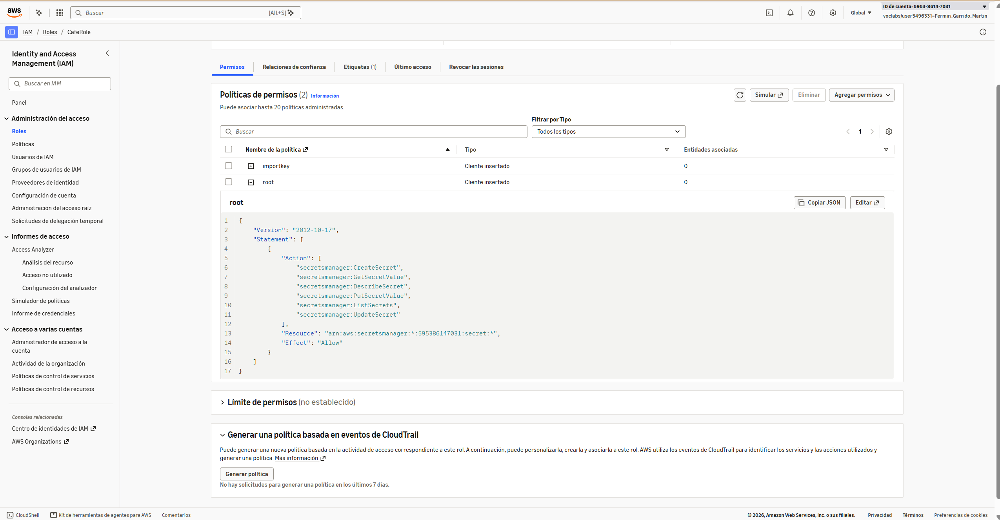

##### 5.3. Asociar `CafeRole` a la instancia `Lab IDE`
1. Regresa a **EC2 > Instancias** (en **Norte de Virginia**) y marca la casilla de **`Lab IDE`**.
2. En el menú superior derecho, haz clic en **Acciones** (*Actions*) > **Seguridad** (*Security*) > **Modificar rol de IAM** (*Modify IAM role*).
3. En el desplegable **Rol de IAM**, selecciona **`CafeRole`**.
4. Pulsa el botón negro **Actualizar rol de IAM** (*Update IAM role*).

**✅ Cómo saber que vas bien:** Aparece un mensaje de confirmación verde en la parte superior de EC2: **`CafeRole se ha asociado correctamente a la instancia i-...`**. ¡Desafío 2 resuelto! (Esto vale **5/5 puntos** en la evaluación final: `[Task 4] Instance permissions`).

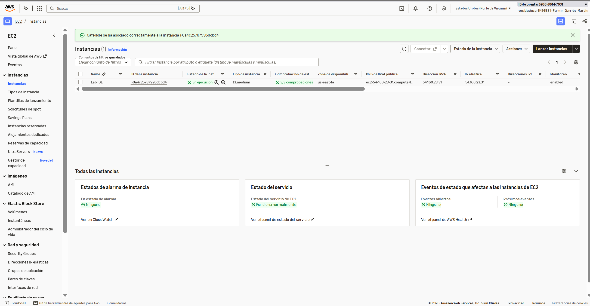

---

<a id="tarea-5"></a>
### Tarea 5: Probar la tienda y realizar pedidos de prueba

Ahora que `Lab IDE` ya tiene el rol **`CafeRole`**, comprobaremos que la aplicación es 100 % dinámica: lee el catálogo desde MariaDB y guarda pedidos nuevos en la base de datos.

1. Vuelve a la pestaña del navegador donde tenías la cafetería (`http://<TU-IP-PUBLICA-VIRGINIA>:8000/cafe`) y haz clic en **`Menu`** (o pulsa **`F5`** para recargar).
2. **✅ Cómo saber que vas bien:** Al instante aparecen las categorías (*Pastries*, bebidas...) con todas las fotos, descripciones, precios y cajas `Quantity` cargadas desde MariaDB.

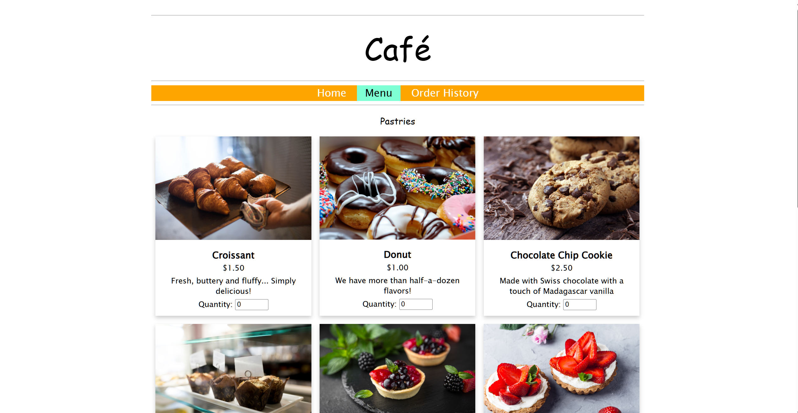

3. **Realiza el Pedido nº 1:**
   * Cambia `Quantity: 0` a `1` (o más) en cualquier producto (por ejemplo, *Hot Chocolate*).
   * Baja hasta el final de la página y pulsa el botón **Submit Order**.
   * Verás la pantalla **Order Confirmation** con tu `Order Number: 1` y el importe total.

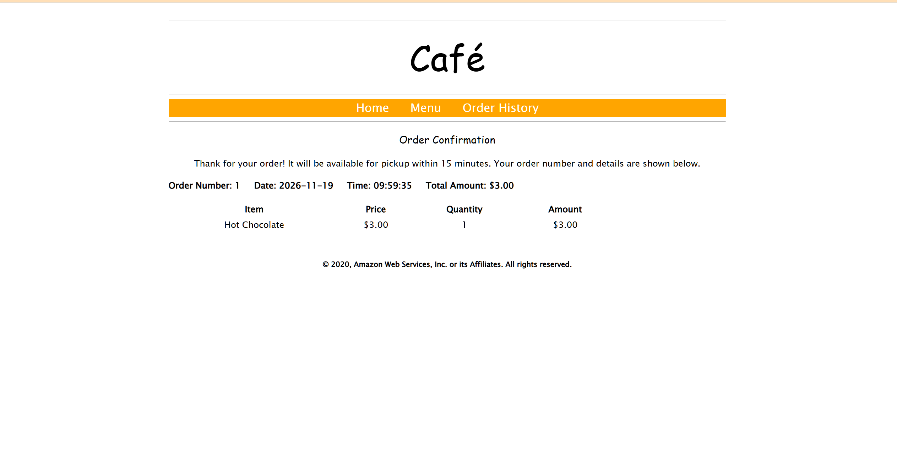

4. **Realiza el Pedido nº 2:**
   * Haz clic de nuevo en **`Menu`** en la barra naranja superior.
   * Selecciona otro producto distinto (por ejemplo, `1` unidad de *Coffee*), baja al final y vuelve a pulsar **Submit Order**.
5. **Comprueba el historial de pedidos:**
   * Haz clic en **`Order History`** en la barra naranja superior.

**✅ Cómo saber que vas bien:** En la pantalla **Order History** aparecen listados tanto el **`Order Number: 1`** como el **`Order Number: 2`** con su fecha, hora, producto y precio, confirmando que la escritura y lectura en MariaDB funcionan a la perfección.

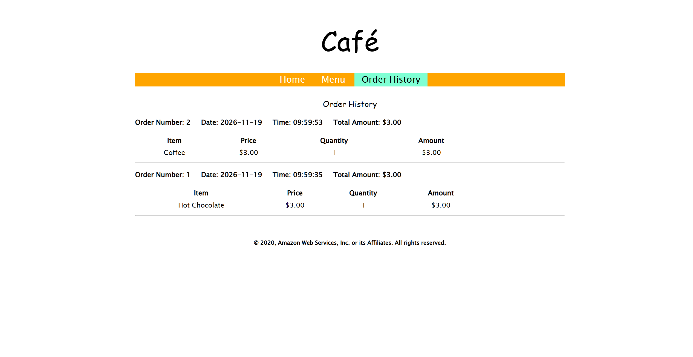

[⬆️ Volver al índice](#inicio)


---

<a id="desafio-3"></a>
## 3. Desafío 3: Crear entornos de desarrollo y producción en dos regiones

**Contexto empresarial:** A los dueños de la cafetería les encanta la nueva tienda en línea, pero no quieren probar cambios futuros directamente delante de los clientes. Deciden dejar la instancia actual de **Norte de Virginia (`us-east-1`)** como entorno de **desarrollo**, y crear una réplica exacta en otra región de AWS (**Oregón / `us-west-2`**) como entorno de **producción**, ganando además protección ante caídas regionales (recuperación ante desastres).

---

<a id="tarea-6"></a>
### Tarea 6: Claves SSH, crear AMI, Preguntas 5 a 7 y desplegar en Oregón

#### Paso 1: Configurar el `hostname` estático y crear un par de claves SSH
Antes de «sacar una foto» (AMI) de nuestra instancia de desarrollo, vamos a fijarle un nombre de host interno (`cafeserver`) y generar un par de claves SSH para que, si más adelante necesitamos conectarnos por terminal al servidor de producción en Oregón, podamos hacerlo sin necesidad de crear claves nuevas en AWS.

1. En la terminal Bash de tu VS Code, asegúrate de situarte en `~/environment` y ejecuta estos tres comandos:

```bash
cd ~/environment
sudo hostname cafeserver
ssh-keygen -t rsa -f ~/.ssh/id_rsa
```

2. El comando `ssh-keygen` te hará dos preguntas seguidas (`Enter passphrase...` y `Enter same passphrase again:`). **Pulsa `Intro` las dos veces sin escribir nada** para dejar la frase de contraseña vacía.
3. Cuando termine de generar la clave, añade la clave pública a `authorized_keys` ejecutando:

```bash
cat ~/.ssh/id_rsa.pub >> ~/.ssh/authorized_keys
```

**✅ Cómo saber que vas bien:** Verás el recuadro ASCII (*randomart image*) de tu clave RSA de 3072 bits y, tras ejecutar el comando `cat`, recuperarás el prompt `[ec2-user@... environment]$` sin mensajes de error.

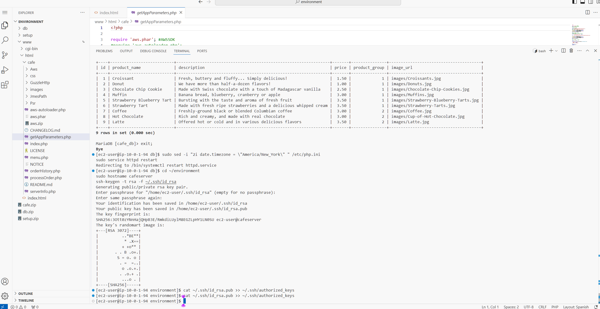

---

#### Paso 2: Abrir el asistente de creación de AMI (¡Sin pulsar aún en Crear!)
1. Ve a la pestaña de la **Consola de AWS** (asegúrate de estar en **Estados Unidos — Norte de Virginia `us-east-1`**) > **EC2** > **Instancias**.
2. Marca la casilla de **`Lab IDE`**.
3. Arriba a la derecha, haz clic en **Acciones** (*Actions*) > **Imagen y plantillas** (*Images and templates*) > **Crear imagen** (*Create image*).

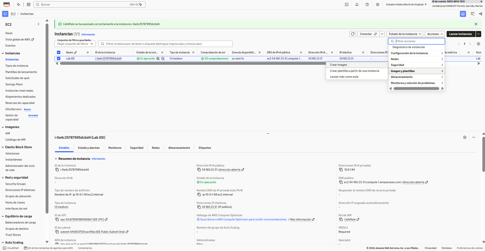

4. Se abrirá el formulario **Crear imagen**. **Antes de darle al botón negro de crear**, observa tres controles clave en pantalla porque contienen las respuestas literales a las **Preguntas 5, 6 y 7** del cuestionario:
   * **Casilla `Reiniciar instancia`:** viene **marcada por defecto**, pero se puede desmarcar (*tienes la opción de no reiniciar*).
   * **Fila del volumen raíz (`/dev/xvda`) en `Volúmenes de instancia`:** fíjate en qué campos están en blanco (editables) y cuáles en gris (bloqueados): puedes editar **`Tamaño`** (`30`) y la casilla **`Eliminar cuando termine`** (`Habilitar`), pero **`Tipo de volumen`** está bloqueado en gris.
   * **Botón `Agregar volumen`:** aparece activo justo debajo de la tabla, permitiéndote añadir más volúmenes EBS a la AMI.

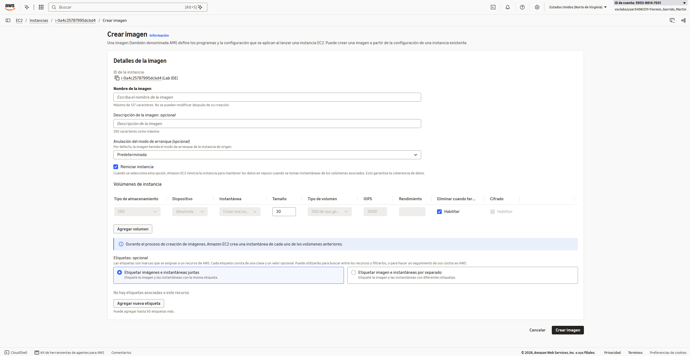

---

#### Paso 3: Responder las Preguntas 5, 6 y 7 en el cuestionario
Deja abierta la pestaña de **Crear imagen** y vuelve a tu pestaña del cuestionario (**Multiple Choice Questions**). Marca estas opciones exactas y **pulsa el botón gris `Submit` / `enviar` debajo de cada una**:

| Nº | Pregunta | Opción correcta (Español) | Opción correcta (Inglés) |
| :--- | :--- | :--- | :--- |
| **5** | Cuando se crea una AMI a partir de una instancia, ¿se reiniciará la instancia? | **Tienes la opción de *no* reiniciar, pero por defecto se reiniciará.** | **You have the option *not* to reboot, but by default it will be rebooted** |
| **6** | ¿De qué maneras se pueden modificar las propiedades del volumen raíz al crear una AMI a partir de una instancia? | **Puedes editar el tamaño y la configuración de "eliminar al finalizar", pero no el tipo de volumen.** | **You can edit the size and 'delete on termination' setting, but not the volume type.** |
| **7** | ¿Se pueden agregar más volúmenes a una AMI creada a partir de una instancia que solo tiene un volumen? | **Sí** | **Yes** |

**✅ Cómo saber que vas bien:** Las 7 preguntas del cuestionario (de la 1 a la 7) tienen su opción seleccionada y has pulsado **`Submit` / `enviar`** debajo de todas y cada una.

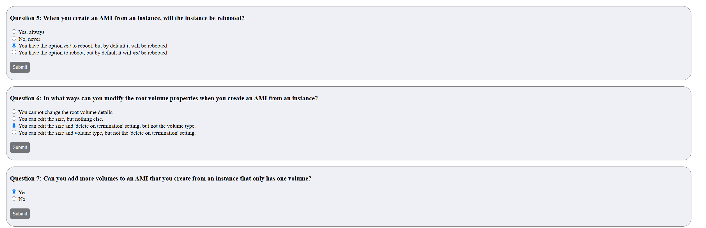

---

#### Paso 4: Crear la AMI `CafeServer` en Norte de Virginia (`us-east-1`)
1. Regresa a la pestaña de la Consola de AWS donde dejaste abierto el formulario **Crear imagen**.
2. En **Nombre de la imagen**, escribe exactamente **`CafeServer`** *(respeta las mayúsculas)* y deja el resto de opciones tal cual vienen.
3. Haz clic en el botón negro **Crear imagen** (*Create image*).

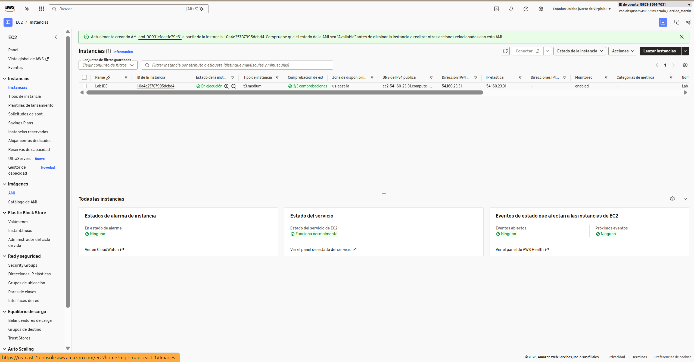

> **⚠️ Ojo aquí (desconexión temporal normal de VS Code):**  
> Como dejamos marcada la opción *Reiniciar instancia* para asegurar la integridad de la base de datos al crear la imagen, `Lab IDE` se reiniciará brevemente. Si ves un aviso de reconexión en la pestaña de VS Code durante 1 o 2 minutos, **no pasa nada**: cuando la AMI termine, recarga VS Code con **`F5`** y volverá a conectar solo.

4. En el menú lateral izquierdo de EC2, dentro de **Imágenes**, haz clic en **AMI**.
5. Verás aparecer **`CafeServer`** en estado **Pendiente**.

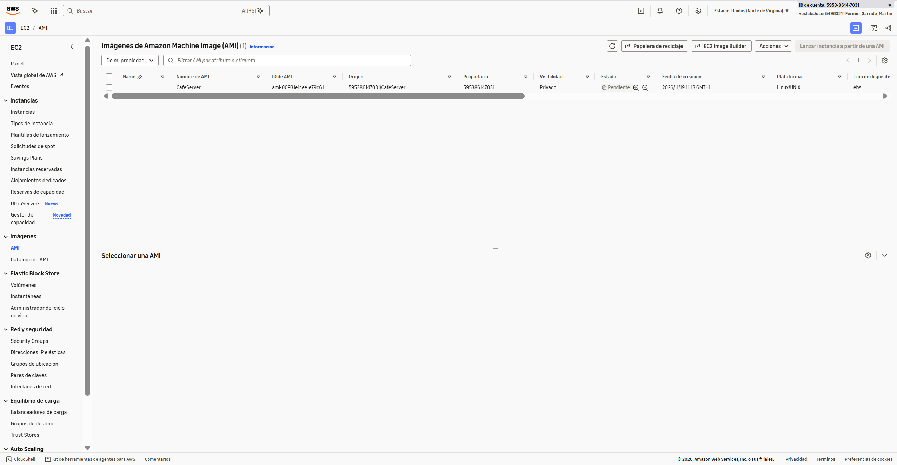

6. Espera unos **2 minutos** (puedes pulsar el botón de recarga circular arriba a la derecha de la tabla) hasta que el estado cambie a **Disponible** en verde. Anota tu **ID de AMI** (`ami-...`) en tu **Hoja de Apuntes**.

**✅ Cómo saber que vas bien:** La AMI `CafeServer` muestra el icono verde **Disponible** en **Estados Unidos (Norte de Virginia)**.

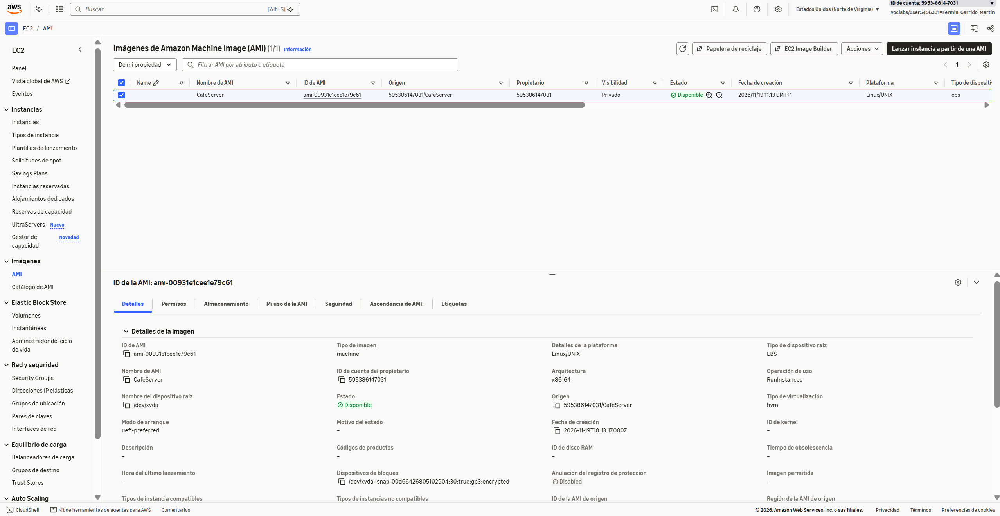

---

#### Paso 5: Resolver el Desafío 3 — Copiar la AMI a la región Oregón (`us-west-2`)

> **💡 Por qué no ves tu AMI si cambias directamente a Oregón:**  
> En AWS, las AMI son recursos **regionales**, no globales. Aunque pertenezcan a tu misma cuenta, una AMI creada en Norte de Virginia (`us-east-1`) **no existe en Oregón (`us-west-2`)** hasta que la copies explícitamente hacia la región de destino.

1. Todavía en **Norte de Virginia (`us-east-1`)**, dentro de **EC2 > Imágenes > AMI**, marca la casilla de **`CafeServer`**.
2. Arriba a la derecha, haz clic en **Acciones** (*Actions*) > **Copiar AMI** (*Copy AMI*).
3. En el desplegable **Región de destino**, selecciona **Estados Unidos (Oregón) `us-west-2`**.
4. Mantén el nombre **`CafeServer`** y pulsa el botón negro **Copiar AMI**.
5. Verás un aviso azul arriba confirmando que la operación de copia hacia `us-west-2` se ha iniciado e indicando el **nuevo ID de AMI** en Oregón (en nuestra sesión: `ami-058f307034e7bcd70`).

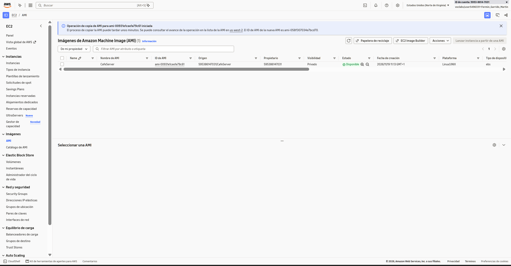

6. Ahora **cambia de región** en la esquina superior derecha de la Consola de AWS: haz clic sobre **Estados Unidos (Norte de Virginia)** y selecciona **Estados Unidos (Oregón) `us-west-2`**.
7. En el menú lateral izquierdo de EC2, entra en **Imágenes > AMI**.
8. Espera entre **3 y 5 minutos** (actualizando la tabla de vez en cuando) hasta que la copia de **`CafeServer`** pase de *Pendiente* a **Disponible**.

**✅ Cómo saber que vas bien:** En la barra superior derecha pone **`Estados Unidos (Oregón)`** y la fila de **`CafeServer`** figura en verde como **Disponible**.

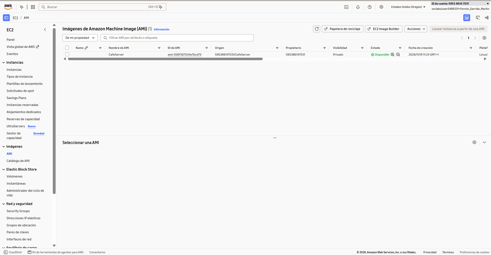

---

#### Paso 6: Lanzar la instancia de producción `ProdCafeServer` en Oregón
Con **`CafeServer`** seleccionada en **EC2 > AMI (Oregón)**, pulsa el botón negro superior derecho **Lanzar instancia a partir de una AMI** y configura estos 6 bloques con mucha atención (el script de calificación revisa cada uno de estos parámetros):

1. **Nombre, tipo de instancia y par de claves:**
   * **Nombre:** escribe exactamente **`ProdCafeServer`** *(crea la etiqueta `Name = ProdCafeServer`)*.
   * **Tipo de instancia:** cambia el valor predeterminado y selecciona **`t2.small`** *(vale 2/2 puntos: `[Task 6C] Instance type`)*.
   * **Par de claves (inicio de sesión):** selecciona **`Continuar sin un par de claves (no recomendado)`** *(nuestra clave RSA del Paso 1 ya viaja incrustada dentro de la AMI)*.

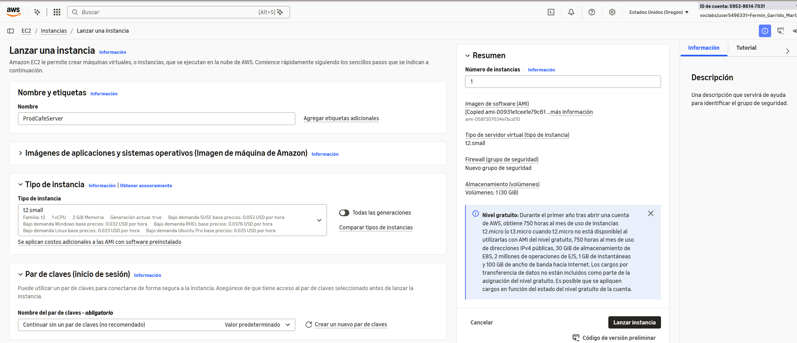

2. **Configuraciones de red** *(haz clic en el botón **Editar**)*:
   * **VPC - obligatorio:** selecciona **`Lab VPC Region 2`**.
   * **Subred:** selecciona **`Public Subnet`** *(vale 2/2 puntos: `[Task 6A] subnet placement`)*.
   * **Asignación automática de IP pública:** comprueba que esté en **`Habilitar`**.
   * **Firewall (grupos de seguridad):** deja marcada la opción **Crear un grupo de seguridad** y en **Nombre del grupo de seguridad** escribe exactamente **`cafeSG`**.
   * **Reglas de grupos de seguridad de entrada (¡añade las DOS reglas!):**
     * **Regla 1:** Tipo **`SSH`** (puerto `22`), Tipo de origen **`Cualquier lugar`** (`0.0.0.0/0`).
     * Pulsa **Agregar regla de grupo de seguridad** → **Regla 2:** Tipo **`TCP personalizado`**, Rango de puertos **`8000`**, Tipo de origen **`Cualquier lugar`** (`0.0.0.0/0`).

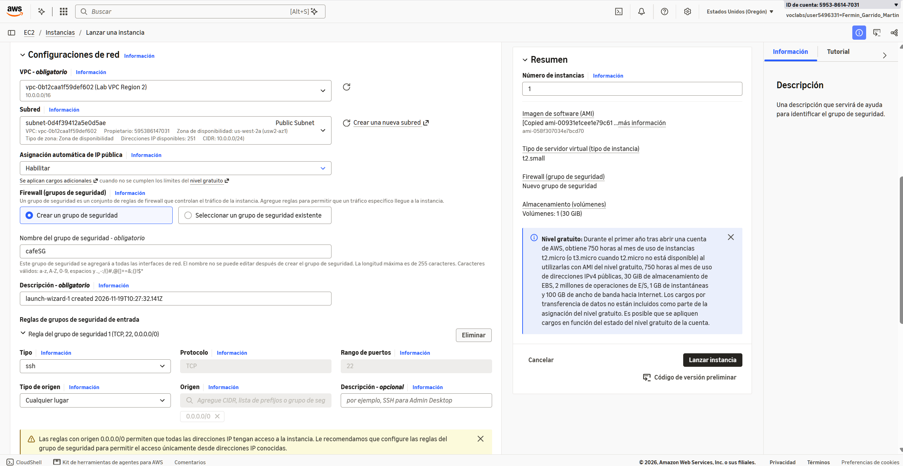

3. **Detalles avanzados** *(despliega la última sección del formulario al final de la página)*:
   * En **Perfil de instancia de IAM**, selecciona **`CafeRole`** *(vale 3/3 puntos: `[Task 6B] Instance role`)*.
   * Pulsa el botón negro **Lanzar instancia**.

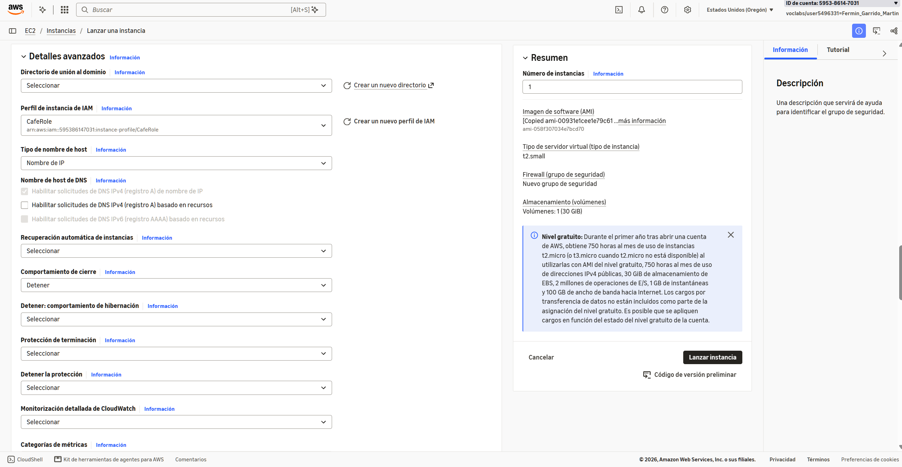

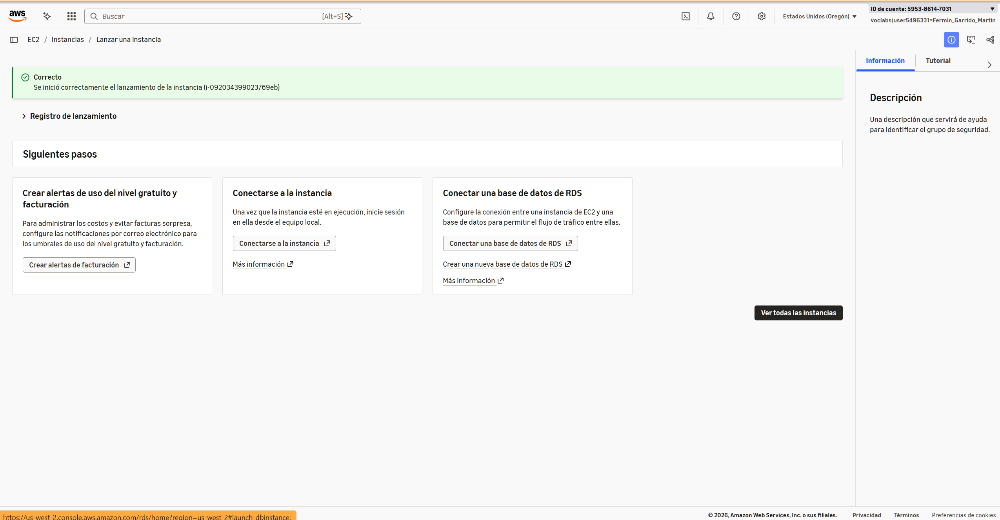

4. Haz clic en **Ver todas las instancias** (en **Oregón**), marca la casilla de **`ProdCafeServer`** y espera unos segundos hasta que la pestaña **Detalles** muestre sus datos de red públicos.
5. **Anota ambos valores en tu Hoja de Apuntes** *(ejemplo de nuestra sesión)*:
   * **Dirección IPv4 pública:** `54.187.196.4`
   * **DNS público de IPv4:** `ec2-54-187-196-4.us-west-2.compute.amazonaws.com`

**✅ Cómo saber que vas bien:** `ProdCafeServer` está **En ejecución** en `us-west-2`, tiene asignada una IPv4 pública y un DNS público terminado en `.us-west-2.compute.amazonaws.com`, pertenece a `Lab VPC Region 2 / Public Subnet`, es `t2.small` y tiene el rol `CafeRole`.

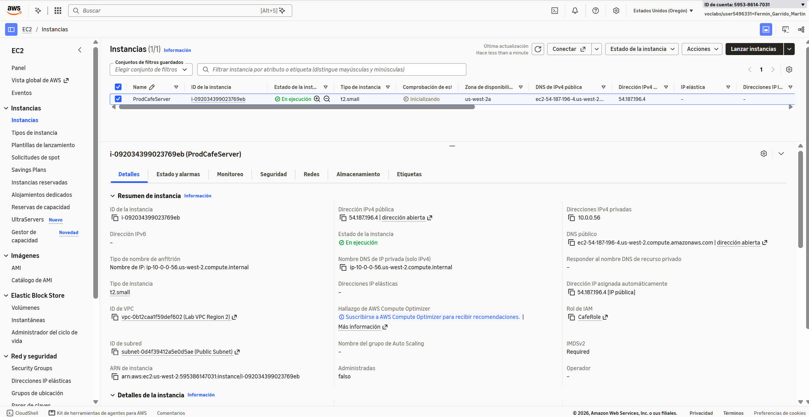

---

#### Paso 7: Crear los 7 secretos en Secrets Manager de Oregón (`us-west-2`)
Al igual que las AMI, los secretos de **AWS Secrets Manager** son **regionales**. Cuando la aplicación PHP arranque en Oregón, buscará sus 7 parámetros en Secrets Manager de `us-west-2`. Vamos a crearlos reutilizando el script desde nuestro IDE de VS Code:

1. Vuelve a la pestaña del **IDE de VS Code** *(si aparece desconectado por el reinicio de la AMI, pulsa **`F5`** para recargar)*.
2. En el panel izquierdo (**`EXPLORER`**), abre el archivo **`setup/set-app-parameters.sh`**.
3. Sustituye el contenido del archivo por el siguiente script completo, **cambiando la línea `publicDNS="..."` por el DNS público real de TU instancia `ProdCafeServer` de Oregón** (manteniendo las comillas y sin ángulos `< >`):

```bash
#!/bin/bash
#
# Script to set the parameters for the cafe application in the Parameter Store.
#
echo
echo "Setting the default AWS region..."
TOKEN=$(curl -X PUT "[http://169.254.169.254/latest/api/token](http://169.254.169.254/latest/api/token)" -H "X-aws-ec2-metadata-token-ttl-seconds: 21600")

az=$(curl -H "X-aws-ec2-metadata-token: $TOKEN" -v [http://169.254.169.254/latest/meta-data/placement/availability-zone](http://169.254.169.254/latest/meta-data/placement/availability-zone))
region="us-west-2"
export AWS_DEFAULT_REGION=$region
echo "Region =" $AWS_DEFAULT_REGION
#
# Set the application parameter values.
#
# ¡ATENCIÓN! Reemplaza el valor entre comillas por TU DNS público IPv4 real de Oregón:
publicDNS="ec2-54-187-196-4.us-west-2.compute.amazonaws.com"
echo "Public DNS =" $publicDNS

echo "Setting the application parameter values in the Secrets Manager..."
aws secretsmanager create-secret --name "/cafe/showServerInfo" --secret-string "false"
aws secretsmanager create-secret --name "/cafe/timeZone" --secret-string "America/New_York"
aws secretsmanager create-secret --name "/cafe/currency" --secret-string "$"
aws secretsmanager create-secret --name "/cafe/dbUrl" --secret-string $publicDNS
aws secretsmanager create-secret --name "/cafe/dbName" --secret-string "cafe_db"
aws secretsmanager create-secret --name "/cafe/dbUser" --secret-string "admin"
aws secretsmanager create-secret --name "/cafe/dbPassword" --secret-string "Lab123#"

echo
echo "Application Secrets Setup script completed."
echo
#following command removes profile attached to the instance so that user can perfom step33, running cafe server as a challenge
aws ec2 disassociate-iam-instance-profile --association-id $(aws ec2 describe-iam-instance-profile-associations --query "IamInstanceProfileAssociations[?contains(IamInstanceProfile.Arn, 'VSCodeInstanceProfile')].AssociationId" --output text)
```

4. **Guarda el archivo (`Ctrl + S`)** y ejecútalo en la terminal Bash de VS Code:

```bash
cd ~/environment/setup/
./set-app-parameters.sh
```

**✅ Cómo saber que vas bien:** La terminal imprime **7 bloques JSON** con `"ARN": "arn:aws:secretsmanager:us-west-2:..."` y termina con el mensaje **`Application Secrets Setup script completed.`**.

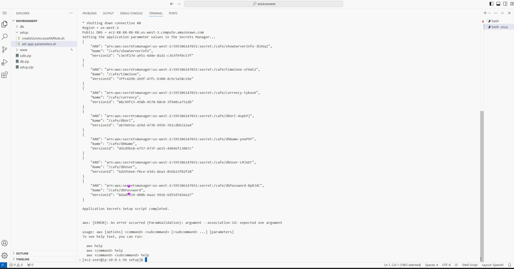

> **⚠️ Tres avisos importantísimos sobre este script (¡léelos antes de alarmarte!):**
> 1. **Error `ParamValidation` al final (100 % normal, ignóralo):** Justo después de `Application Secrets Setup script completed.`, verás un mensaje rojo/blanco diciendo `aws: [ERROR]: An error occurred (ParamValidation): argument --association-id: expected one argument`. **No significa que haya fallado nada**: la última línea intenta desasociar el antiguo rol `VSCodeInstanceProfile` que ya reemplazamos antes por `CafeRole`. Los 7 secretos de Oregón ya están creados.
> 2. **Si te equivocaste en el `publicDNS` (por ejemplo, dejaste `XX-XX-XX-XX`):** No vuelvas a ejecutar el script (te diría que los secretos ya existen). Actualiza únicamente `/cafe/dbUrl` con este comando de una sola línea:
>    ```bash
>    aws secretsmanager put-secret-value --region us-west-2 --secret-id "/cafe/dbUrl" --secret-string "<TU-DNS-PUBLICO-REAL-OREGON>"
>    ```
>    Verás un JSON corto con `"VersionStages": ["AWSCURRENT"]` confirmando la corrección:
>    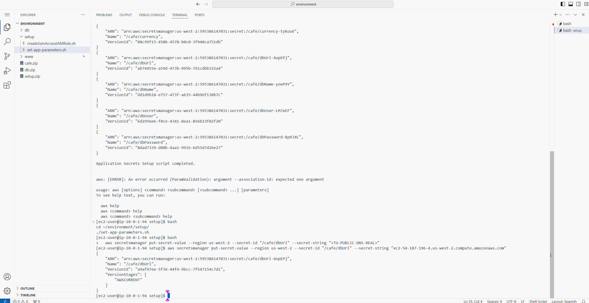
> 3. **Si te sale un error de credenciales caducadas (*ExpiredToken*):** Ejecuta estos tres comandos en la terminal y vuelve a lanzar `./set-app-parameters.sh`:
>    ```bash
>    wget [https://aws-tc-largeobjects.s3-us-west-2.amazonaws.com/ILT-TF-200-ACACAD-20-EN/mod4-challenge/cred-update.sh](https://aws-tc-largeobjects.s3-us-west-2.amazonaws.com/ILT-TF-200-ACACAD-20-EN/mod4-challenge/cred-update.sh)
>    chmod +x cred-update.sh
>    ./cred-update.sh
>    ```

[⬆️ Volver al índice](#inicio)

---

<a id="tarea-7"></a>
### Tarea 7: Verificar producción en Oregón, enviar el laboratorio y lograr 30/30

#### Paso 1: Revisar que `cafeSG` tenga el puerto `8000` abierto
Antes de abrir la web de producción, haz una comprobación de 10 segundos en **EC2 > Instancias (Oregón)**:
1. Selecciona **`ProdCafeServer`** y abre la pestaña inferior **Seguridad**.
2. Confirma que el **Rol de IAM** es **`CafeRole`** y revisa la tabla **Reglas de entrada** de **`cafeSG`**.

> **⚠️ Error muy frecuente al lanzar `ProdCafeServer`:** Al crear el grupo `cafeSG` en el asistente, es facilísimo dejar solo la regla `SSH (22)` y olvidarse de pulsar *Agregar regla* para el puerto `8000` (como se ve en la captura inferior). Si en tu tabla solo aparece el puerto **`22`**, haz clic en el enlace azul de **`cafeSG`** → **Editar reglas de entrada** → **Agregar regla** → `TCP personalizado`, puerto **`8000`**, origen **`0.0.0.0/0`** y pulsa **Guardar reglas**.

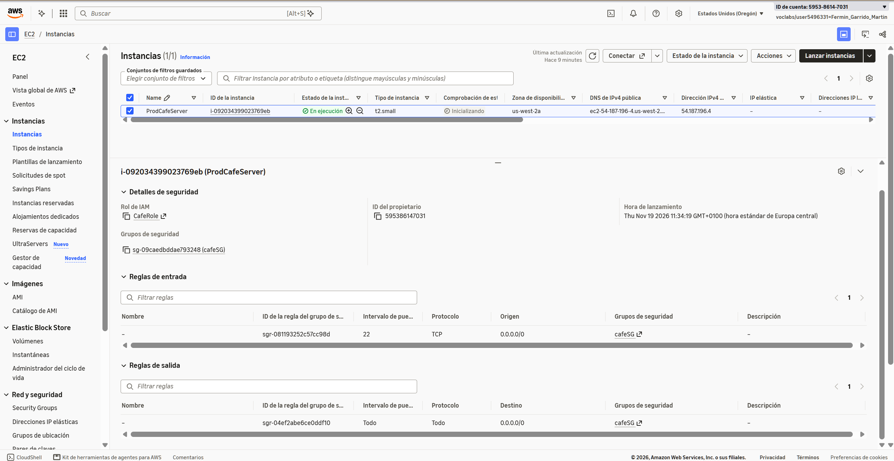

---

#### Paso 2: Probar el servidor de producción en el navegador
1. Abre una pestaña nueva en tu navegador y entra en tu **IPv4 pública de Producción (Oregón)** por el puerto `8000`:
   ```text
   http://<TU-IP-PUBLICA-OREGON>:8000
   ```
   *(Ejemplo de nuestra sesión: `http://54.187.196.4:8000`)*

**✅ Cómo saber que vas bien:** Carga al instante el mensaje **`Hello from the café web server!`** servido desde Oregón.

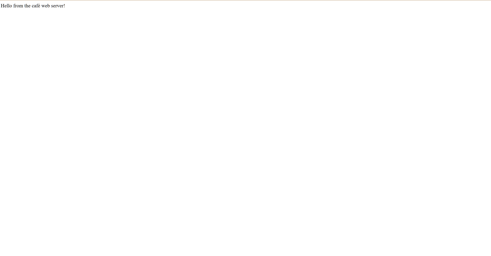

2. Ahora abre la aplicación completa de la cafetería en producción:
   ```text
   http://<TU-IP-PUBLICA-OREGON>:8000/cafe/
   ```
3. Haz clic en **`Menu`** (deben cargarse los 9 productos con sus precios desde la base de datos local de Oregón gracias a `CafeRole` y a los 7 secretos de `us-west-2`).
4. Realiza uno o dos pedidos de prueba nuevos (por ejemplo, un *Latte* y un *Hot Chocolate*) pulsando **Submit Order**.
5. Entra en **`Order History`**.

**✅ Cómo saber que vas bien:** En el historial de producción verás tanto los **pedidos `1` y `2`** (heredados automáticamente dentro de la base de datos cuando clonaste la AMI desde Virginia) como tus **nuevos pedidos `3` y `4`** registrados ya de forma independiente en Oregón.

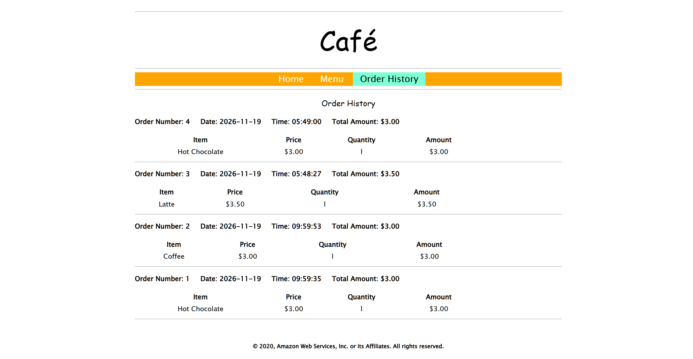

> **💡 Herramienta extra de diagnóstico (SSH hacia producción):**  
> Si en algún momento la web de Oregón no cargara y quisieras entrar por terminal a `ProdCafeServer` para revisar Apache o MariaDB, puedes conectarte directamente desde la terminal de tu VS Code en Virginia usando la clave generada en la Tarea 6:
> ```bash
> ssh -i ~/.ssh/id_rsa ec2-user@<TU-IP-PUBLICA-OREGON>
> ```

---

#### Paso 3: Enviar el laboratorio (`Submit`), verificar `30/30` y cerrar sesión
1. Haz un último repaso rápido en tu pestaña del cuestionario para asegurarte de haber pulsado **`Submit` / `enviar`** en las **7 preguntas** (1 a 7).
2. Regresa a la pestaña principal del laboratorio de **AWS Academy**.
3. Pulsa arriba a la derecha el botón negro **`Submit`** y confirma con **`Yes`**.
4. Espera entre 1 y 2 minutos y haz clic en el botón **`Grades`** (o en **`Submission Report`** si quieres ver el comentario detallado de cada comprobación).

**✅ Cómo saber que has completado el laboratorio al 100 %:**  
En el panel derecho aparece **`Total score: 30/30`** con todos los apartados al máximo (`[Answer 01]`–`[Answer 07]`, `[Task 3] Web server SG config: 5/5`, `[Task 4] Instance permissions: 5/5`, `[Task 6A] subnet placement: 2/2`, `[Task 6B] Instance role: 3/3`, `[Task 6C] Instance type: 2/2`, más las comprobaciones del resto del informe).

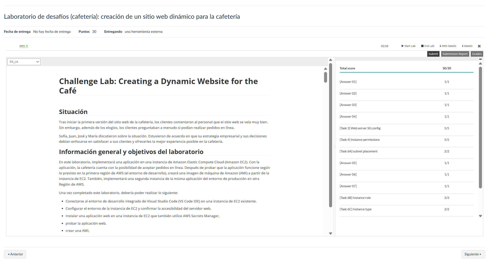

5. **Paso final obligatorio:** Una vez confirmada tu nota de **`30/30`**, pulsa **`End Lab`** arriba a la derecha y confirma con **`Yes`** para apagar y liberar limpiamente todos los recursos de AWS.

[⬆️ Volver al índice](#inicio)