<a id="inicio"></a>
# Guía de Resolución: Laboratorio de desafíos (Cafetería)
**Módulo 5 — Creación de un sitio web dinámico para la cafetería**  
*AWS Academy Cloud Architecting*

---

## Índice de Contenidos
0. [Fase Previa: Inicio del laboratorio, credenciales y acceso al cuestionario](#fase-previa)
1. [Desafío 1: Preparar una instancia de EC2 para alojar un sitio web](#desafio-1)
   - [Tarea 1: Analizar la instancia de EC2 existente](#tarea-1)
   - [Tarea 1.1: Preguntas sobre la instancia (Preguntas 1 a 4)](#tarea-1-1)
   - [Tarea 2: Conectarse al IDE de VS Code en la instancia de EC2](#tarea-2)
   - [Tarea 3: Configurar la pila LAMP y abrir el acceso web (Puerto 8000)](#tarea-3)
2. [Desafío 2: Instalar la aplicación web dinámica en EC2](#desafio-2)
   - [Tarea 4: Instalar la aplicación, Secrets Manager, MySQL y Rol IAM](#tarea-4)
   - [Tarea 5: Probar la aplicación web](#tarea-5)
3. [Desafío 3: Crear entornos de desarrollo y producción en distintas regiones](#desafio-3)
   - [Tarea 6: Crear una AMI, responder Preguntas 5 a 7 y desplegar en Oregón](#tarea-6)
   - [Tarea 7: Verificar la nueva instancia de producción](#tarea-7)

---

<a id="fase-previa"></a>
## 0. Fase Previa: Inicio del laboratorio, credenciales y acceso al cuestionario

### Paso 1: Iniciar el entorno (`Start Lab`)
1. En la parte superior derecha de la página del laboratorio de AWS Academy, haz clic en **Start Lab**.
2. El temporizador comenzará su cuenta atrás y el círculo situado a la derecha de **AWS** (esquina superior izquierda) se mostrará en **amarillo** mientras se aprovisionan los recursos iniciales.

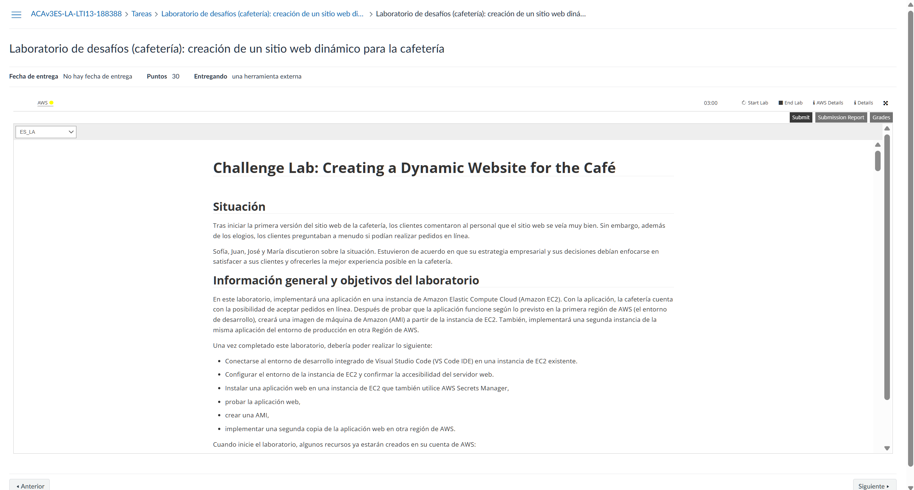

3. Espera unos minutos hasta que el círculo cambie a **verde**, indicando que el entorno está listo para trabajar.

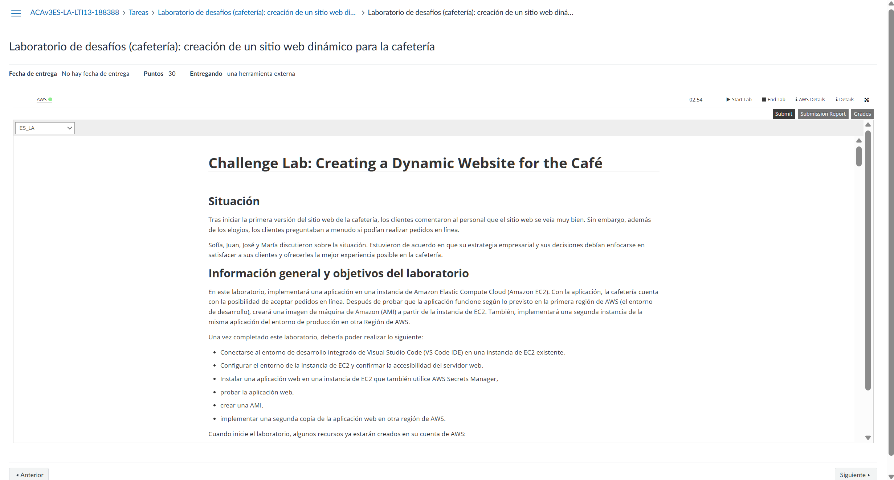

### Paso 2: Abrir `AWS Details` y acceder al cuestionario
1. En la barra superior derecha, haz clic en **AWS Details**.
2. En el panel desplegable encontrarás el enlace **Access the multiple choice questions** y los valores **`LabIDEURL`** y **`LabIDEPassword`** (guárdalos en un bloc de notas para la Tarea 2).

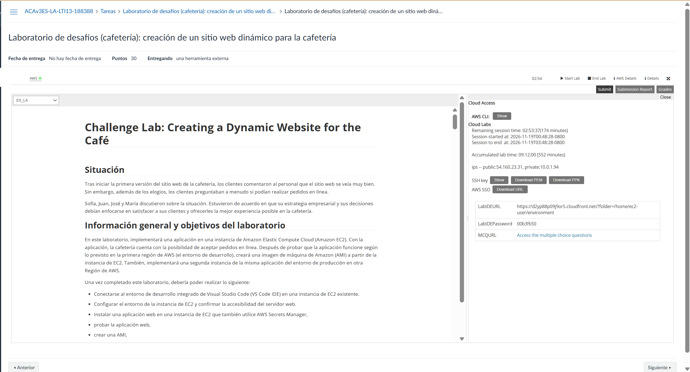

3. Haz clic en **Access the multiple choice questions** para abrir el test de 7 preguntas en una pestaña nueva. Mantén esta pestaña abierta durante todo el laboratorio.

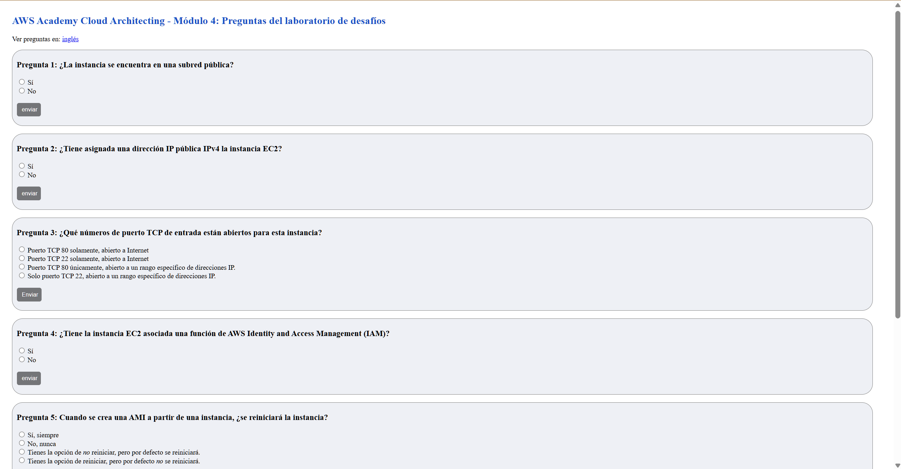

### Paso 3: Abrir la Consola de administración de AWS
1. Regresa a la pestaña del laboratorio y haz clic sobre el enlace **AWS** (junto al punto verde).
2. Se abrirá la **Consola de administración de AWS** en la región **Estados Unidos (Norte de Virginia / `us-east-1`)**.

---

<a id="desafio-1"></a>
## 1. Desafío 1: Preparar una instancia de EC2 para alojar un sitio web

<a id="tarea-1"></a>
### Tarea 1: Analizar la instancia de EC2 existente

**Objetivo:** Examinar la configuración de red, IP pública, puertos de entrada y rol de IAM de la instancia `Lab IDE` creada al iniciar el laboratorio.

#### Paso 1: Acceder a Amazon EC2
1. En la barra de búsqueda superior de la consola de AWS, escribe **EC2** y selecciona el servicio **EC2 (Servidores virtuales en la nube)**.

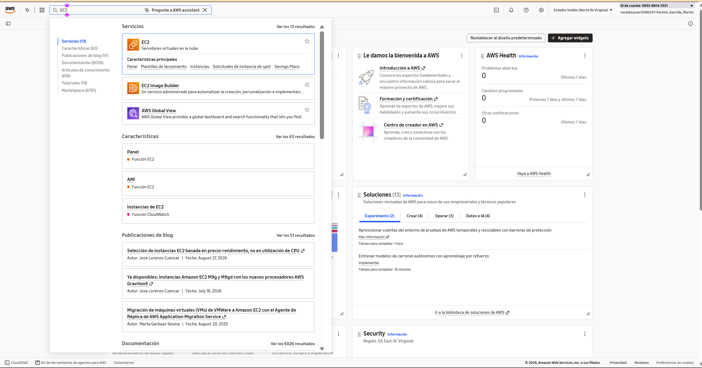

2. En el menú lateral izquierdo, haz clic en **Instancias** (*Instances*).
3. Selecciona la casilla de la instancia en ejecución llamada **`Lab IDE`** (`t3.medium`, zona de disponibilidad `us-east-1a`).

#### Paso 2: Inspeccionar la pestaña Detalles
En el panel inferior, dentro de la pestaña **Detalles**, comprobamos los datos clave de la instancia *(los valores de IP e IDs cambian en cada sesión de laboratorio)*:

* **ID de la instancia:** `i-0a4c25787995dcbd4`
* **Dirección IPv4 pública (y Elastic IP):** `54.160.23.31` *(Anótala; la utilizaremos para probar el servidor web en las Tareas 3, 4 y 5).*
* **ID de VPC:** `vpc-01c678061865658e7 (IDE VPC)`
* **ID de subred:** `subnet-041d537551cac4fda (IDE Public Subnet One)`
* **Rol de IAM:** `...VSCodeInstanceRole-...` *(Sí tiene un rol de IAM asociado por defecto para el funcionamiento del IDE).*

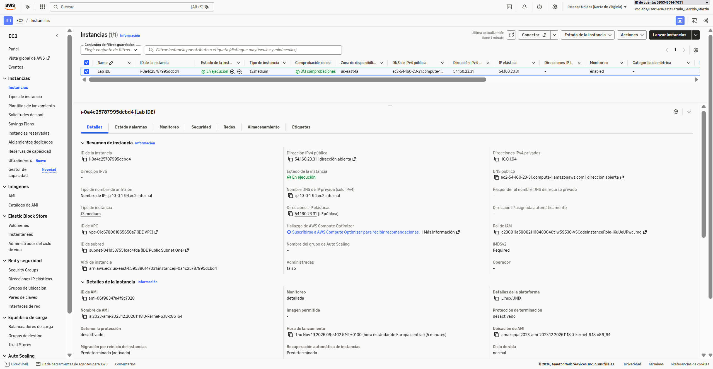

#### Paso 3: Confirmar la subred pública
Al hacer clic sobre el enlace azul del **ID de subred** (`subnet-041d537551cac4fda`), se abre la consola de VPC mostrando la configuración de la subred:

* **Nombre:** `IDE Public Subnet One`
* **CIDR IPv4:** `10.0.1.0/24`
* **Asignación automática de la dirección IPv4 pública:** `Sí`

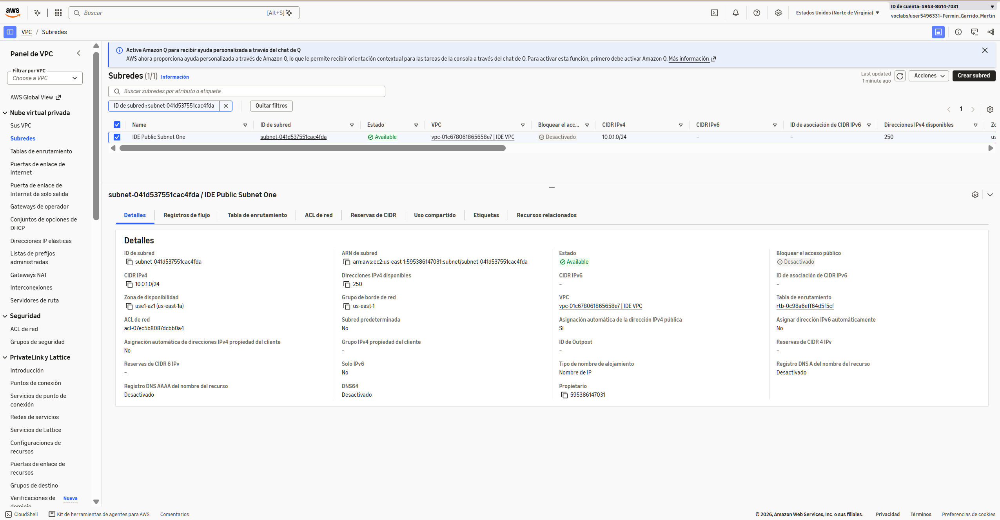

#### Paso 4: Inspeccionar la pestaña Seguridad (Puertos de entrada)
De vuelta en **EC2 > Instancias**, con `Lab IDE` seleccionada, abre la pestaña inferior **Seguridad**:

* **Rol de IAM:** Se confirma el rol `...VSCodeInstanceRole-...`.
* **Grupo de seguridad:** `Lab IDE SG` (`sg-0ce6e0b1a6af32c20`).
* **Reglas de entrada (Inbound rules):**
  * **Intervalo de puertos:** `80`
  * **Protocolo:** `TCP`
  * **Origen:** `pl-3b927c52` (*Allow HTTP from com.amazonaws.global.cloudfront.origin-facing*).
  * **Análisis clave:** El puerto `80` **no está abierto a todo Internet (`0.0.0.0/0`)**, sino restringido a una **lista de prefijos** (un rango específico de direcciones IP pertenecientes a Amazon CloudFront).

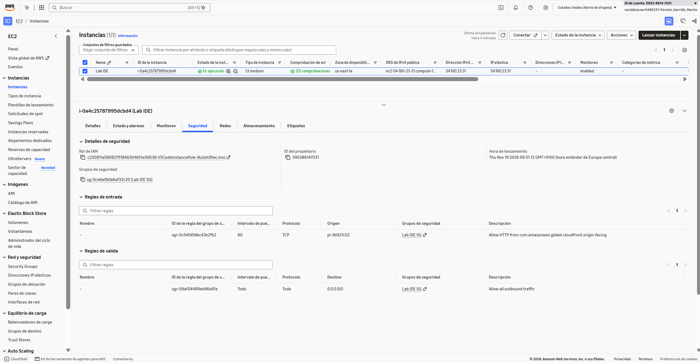

---

<a id="tarea-1-1"></a>
### Tarea 1.1: Preguntas sobre la instancia (Preguntas 1 a 4)

En la pestaña del cuestionario, selecciona cada respuesta y pulsa su botón **enviar** para guardarla:

| Nº | Pregunta | Respuesta correcta | Justificación basada en la consola |
| :--- | :--- | :--- | :--- |
| **1** | ¿La instancia se encuentra en una subred pública? | **Sí** | Pertenece a `IDE Public Subnet One`, con asignación automática de IPv4 pública activada. |
| **2** | ¿Tiene asignada una dirección IP pública IPv4 la instancia EC2? | **Sí** | Cuenta con una IPv4 pública asignada (en este laboratorio: `54.160.23.31`). |
| **3** | ¿Qué números de puerto TCP de entrada están abiertos para esta instancia? | **Puerto TCP 80 únicamente, abierto a un rango específico de direcciones IP.** | En `Lab IDE SG` solo está abierto el puerto `80/TCP` con origen en la lista de prefijos `pl-3b927c52` (rango de IPs de CloudFront), no `0.0.0.0/0`. |
| **4** | ¿Tiene la instancia EC2 asociada una función de AWS Identity and Access Management (IAM)? | **Sí** | La instancia tiene asociado por defecto el rol `...VSCodeInstanceRole-...`. |

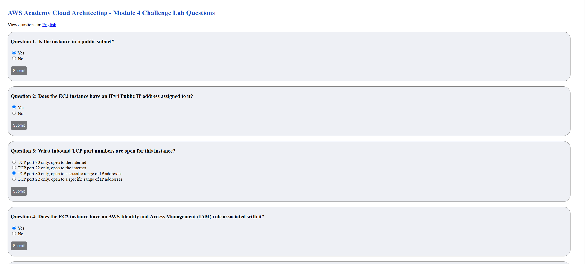

[⬆️ Volver al índice](#inicio)

<a id="tarea-2"></a>
### Tarea 2: Conectarse al IDE de VS Code en la instancia de EC2

**Objetivo:** Acceder al entorno de desarrollo integrado (VS Code / `code-server`) desplegado dentro de la instancia `Lab IDE` para disponer de un editor de archivos y una terminal Bash directamente en el navegador.

#### Paso 1: Obtener las credenciales en `AWS Details`
1. En la parte superior derecha de la ventana del laboratorio, abre el panel **AWS Details** (como vimos en la Fase Previa).
2. Localiza y copia en un bloc de notas los dos valores de conexión *(estos valores se regeneran automáticamente en cada sesión del laboratorio)*:
   * **`LabIDEURL`:** `https://d2yp88p09j9or5.cloudfront.net/?folder=/home/ec2-user/environment`
   * **`LabIDEPassword`:** `00b3f650`

> **💡 Curiosidad técnica:** La URL utiliza un dominio de **Amazon CloudFront** (`*.cloudfront.net`). Por este motivo, en la Tarea 1 comprobamos que el puerto `80` del grupo de seguridad `Lab IDE SG` no estaba abierto a todo Internet (`0.0.0.0/0`), sino únicamente al rango gestionado de IPs de CloudFront (`pl-3b927c52`).

#### Paso 2: Iniciar sesión en `code-server`
1. Abre una pestaña nueva en el navegador y pega la dirección copiada de **`LabIDEURL`**.
2. En la pantalla de bienvenida **Welcome to code-server**, introduce la contraseña de **`LabIDEPassword`** en el campo `PASSWORD` y haz clic en el botón azul **SUBMIT**.

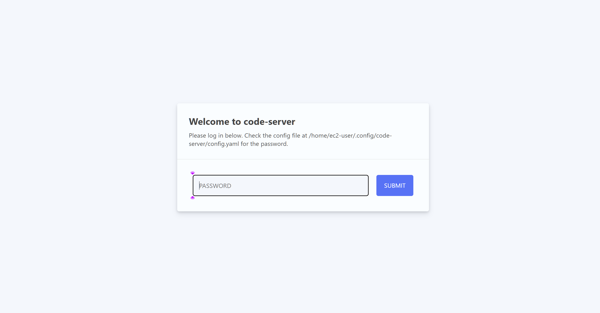

#### Paso 3: Verificar el espacio de trabajo en VS Code
Una vez autenticado, se abrirá el entorno de VS Code con tres áreas principales:
* **Explorador de archivos (panel izquierdo):** Apunta al directorio `/home/ec2-user/environment`.
* **Editor de archivos (panel superior derecho):** Donde abriremos y editaremos el código HTML/PHP y los scripts.
* **Terminal Bash (panel inferior derecho):** Conectada como `[ec2-user@ip-10-0-1-94 environment]$`, desde donde ejecutaremos todos los comandos de administración del servidor.

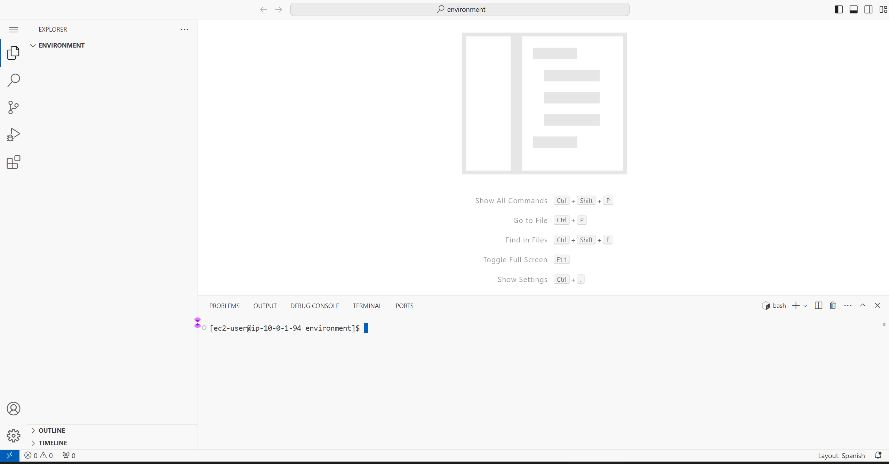

[⬆️ Volver al índice](#inicio)


<a id="tarea-3"></a>
### Tarea 3: Configurar el entorno de la pila LAMP y confirmar el acceso al servidor web (Desafío 1)

**Objetivo:** Verificar el sistema operativo y PHP, reconfigurar Apache en el puerto `8000` (el puerto `80` está reservado para el IDE de VS Code), instalar MariaDB, crear una página de prueba y habilitar el tráfico entrante desde Internet en el grupo de seguridad.

#### Paso 1: Verificar sistema operativo, configurar Apache en el puerto 8000 y comprobar PHP
En la terminal Bash de VS Code, ejecuta los siguientes comandos:

```bash
cat /proc/version
```

A continuación, cambia el puerto de escucha de Apache del `80` al `8000`, inicia el servicio, actívalo en el arranque automático y verifica tanto su estado como la versión de PHP instalada:

```bash
sudo sed -i 's/Listen 80/Listen 8000/g' /etc/httpd/conf/httpd.conf
sudo systemctl start httpd
sudo systemctl enable httpd
sudo service httpd status
php --version
```

> **💡 Nota:** Si el comando `status` pausa la terminal mostrando la salida en pantalla, pulsa la tecla **`q`** para regresar al prompt.

En la salida confirmamos que estamos en **Amazon Linux 2023**, que `httpd.service` está **`active (running)`** escuchando en el puerto **`8000`**, y que disponemos de **PHP 8.5.12**.

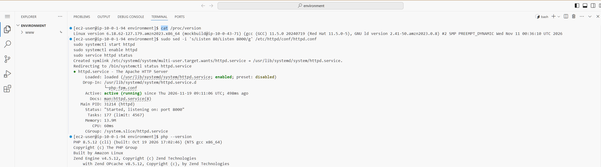

#### Paso 2: Instalar y habilitar MariaDB
Instala el servidor de base de datos MariaDB 10.5, inícialo y habilítalo para que arranque automáticamente tras cualquier reinicio de la instancia:

```bash
sudo dnf install -y mariadb105-server
sudo systemctl start mariadb
sudo systemctl enable mariadb
sudo mariadb --version
sudo service mariadb status
```

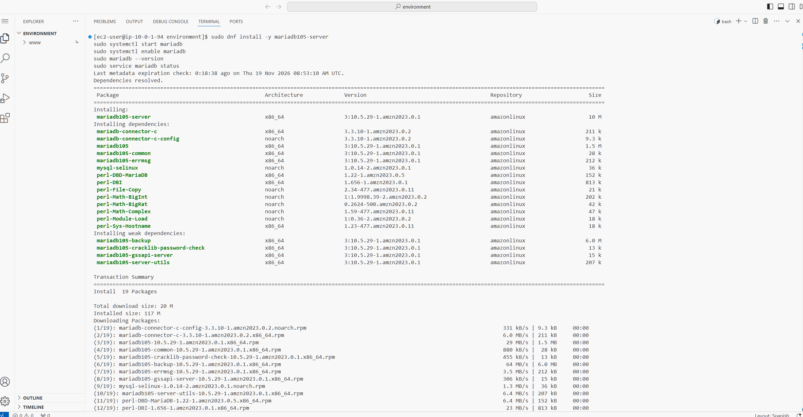

#### Paso 3: Vincular el directorio web al explorador de VS Code
Crea un enlace simbólico desde `/var/www/` hacia tu espacio de trabajo `/home/ec2-user/environment` y asigna la propiedad de `/var/www/html` a `ec2-user` para poder editar páginas directamente desde VS Code:

```bash
ln -s /var/www/ /home/ec2-user/environment
sudo chown ec2-user:ec2-user /var/www/html
```

Comprueba en la salida que `mariadb.service` figura como **`active (running)`** (*Taking your SQL requests now...*) y que en el panel izquierdo (**EXPLORER**) aparece ahora la carpeta **`www`**.

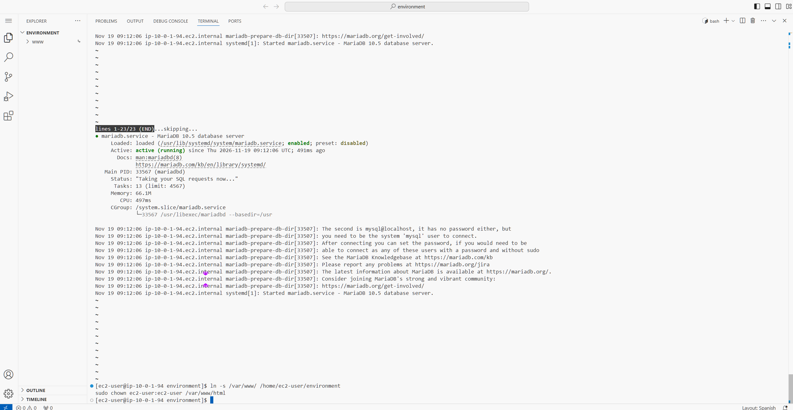

#### Paso 4: Crear la página web de prueba (`index.html`)
1. En el panel izquierdo de VS Code, despliega **`ENVIRONMENT > www`** y selecciona la carpeta **`html`**.
2. Crea un archivo nuevo llamado **`index.html`** (*clic derecho > New File* o menú `File > New File`).
3. Pega el siguiente código HTML y guarda el archivo (`Ctrl + S`):

```html
<html>Hello from the café web server!</html>
```

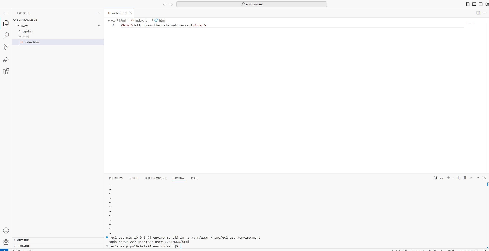

#### Paso 5: Resolución del Desafío 1 — Abrir el puerto TCP 8000 en el Grupo de Seguridad
1. **Comprobación del problema:** Al abrir una pestaña nueva en el navegador e intentar cargar `http://54.160.23.31:8000` *(sustituir por la IPv4 pública de tu sesión)*, el navegador devuelve **`ERR_CONNECTION_TIMED_OUT`**. Esto ocurre porque el grupo de seguridad `Lab IDE SG` solo permite tráfico entrante en el puerto `80` (desde CloudFront), bloqueando el puerto `8000`.

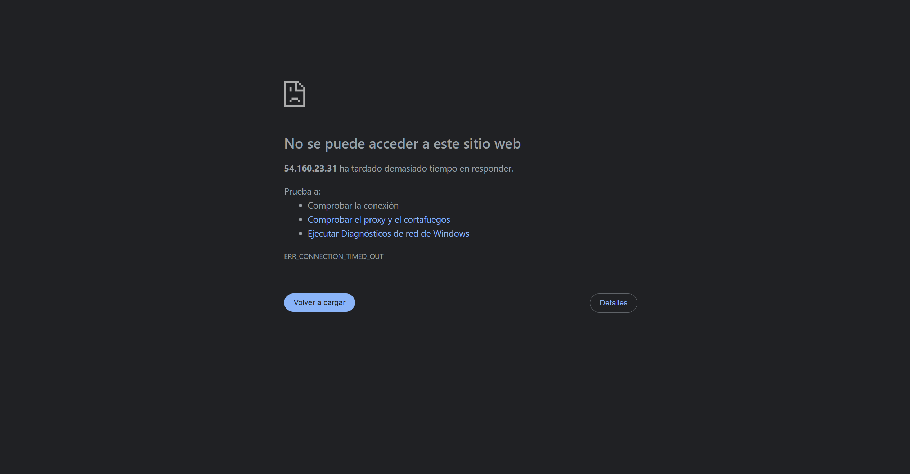

2. **Solución en la Consola de AWS:**
   * Ve a **EC2 > Instancias**, selecciona **`Lab IDE`** y abre la pestaña inferior **Seguridad**.
   * Haz clic en el enlace del grupo de seguridad **`sg-0ce6e0b1a6af32c20 (Lab IDE SG)`**.
   * En la pestaña **Reglas de entrada**, pulsa **Editar reglas de entrada** y haz clic en **Agregar regla**.
   * Configura la nueva regla con estos valores y pulsa **Guardar reglas**:
     * **Tipo:** `TCP personalizado` (*Custom TCP*)
     * **Intervalo de puertos:** `8000`
     * **Tipo de origen / Origen:** `Anywhere-IPv4` (`0.0.0.0/0`)
     * **Descripción (opcional):** `Permitir HTTP puerto 8000 para la cafeteria`

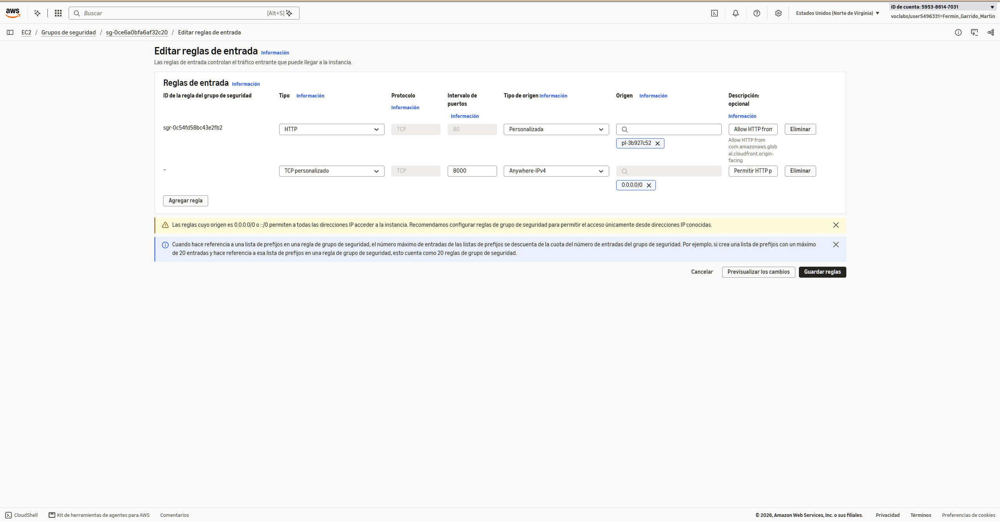

3. **Verificación desde Internet:** Recarga `http://54.160.23.31:8000` en el navegador. Ahora la página carga instantáneamente mostrando **`Hello from the café web server!`**, confirmando que el servidor web Apache es accesible desde Internet.


[⬆️ Volver al índice](#inicio)


---

<a id="desafio-2"></a>
## 2. Desafío 2: Instalar la aplicación web dinámica en EC2

<a id="tarea-4"></a>
### Tarea 4: Instalar la aplicación de la cafetería, Secrets Manager y MySQL

**Objetivo:** Desplegar el código PHP de la cafetería y el AWS SDK, almacenar los parámetros de conexión en **AWS Secrets Manager**, crear la base de datos `cafe_db` en MariaDB y resolver el problema de permisos IAM que impide consultar el menú.

#### Paso 1: Descargar y descomprimir la aplicación y el AWS SDK para PHP
En la terminal Bash de VS Code, ejecuta los siguientes comandos para descargar los paquetes (`setup.zip`, `db.zip`, `cafe.zip` y el AWS SDK para PHP) y conceder permisos de lectura:

```bash
cd ~/environment
wget [https://aws-tc-largeobjects.s3.us-west-2.amazonaws.com/CUR-TF-200-ACACAD-3-113230/03-lab-mod5-challenge-EC2/s3/setup.zip](https://aws-tc-largeobjects.s3.us-west-2.amazonaws.com/CUR-TF-200-ACACAD-3-113230/03-lab-mod5-challenge-EC2/s3/setup.zip)
unzip setup.zip
wget [https://aws-tc-largeobjects.s3.us-west-2.amazonaws.com/CUR-TF-200-ACACAD-3-113230/03-lab-mod5-challenge-EC2/s3/db.zip](https://aws-tc-largeobjects.s3.us-west-2.amazonaws.com/CUR-TF-200-ACACAD-3-113230/03-lab-mod5-challenge-EC2/s3/db.zip)
unzip db.zip
wget [https://aws-tc-largeobjects.s3.us-west-2.amazonaws.com/CUR-TF-200-ACACAD-3-113230/03-lab-mod5-challenge-EC2/s3/cafe.zip](https://aws-tc-largeobjects.s3.us-west-2.amazonaws.com/CUR-TF-200-ACACAD-3-113230/03-lab-mod5-challenge-EC2/s3/cafe.zip)
unzip cafe.zip -d /var/www/html/
cd /var/www/html/cafe/
wget [https://docs.aws.amazon.com/aws-sdk-php/v3/download/aws.zip](https://docs.aws.amazon.com/aws-sdk-php/v3/download/aws.zip)
wget [https://docs.aws.amazon.com/aws-sdk-php/v3/download/aws.phar](https://docs.aws.amazon.com/aws-sdk-php/v3/download/aws.phar)
unzip aws -d /var/www/html/cafe/
chmod -R +r /var/www/html/cafe/
```

Si abres el archivo `www/html/cafe/getAppParameters.php` desde el explorador de VS Code, verás que la aplicación invoca `aws.phar` (AWS SDK) y crea un cliente `SecretsManagerClient` para obtener los parámetros de configuración de forma segura sin escribir contraseñas en el código fuente.

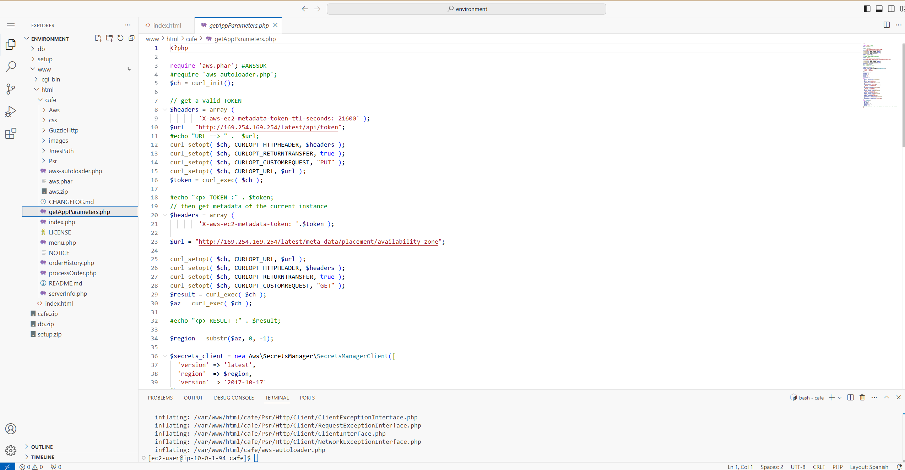

#### Paso 2: Crear los 7 parámetros en AWS Secrets Manager
1. En la terminal Bash, ejecuta el script de configuración de parámetros:

```bash
cd ~/environment/setup/
./set-app-parameters.sh
```

> **💡 Detalle clave para el Desafío 2:** Al finalizar la creación de los 7 secretos, este script ejecuta automáticamente la desasociación (`"State": "disassociating"`) del perfil de instancia IAM por defecto de `Lab IDE`, dejando temporalmente la instancia sin rol de IAM.

2. En la Consola de administración de AWS, busca **Secrets Manager** en la barra superior y accede al servicio.

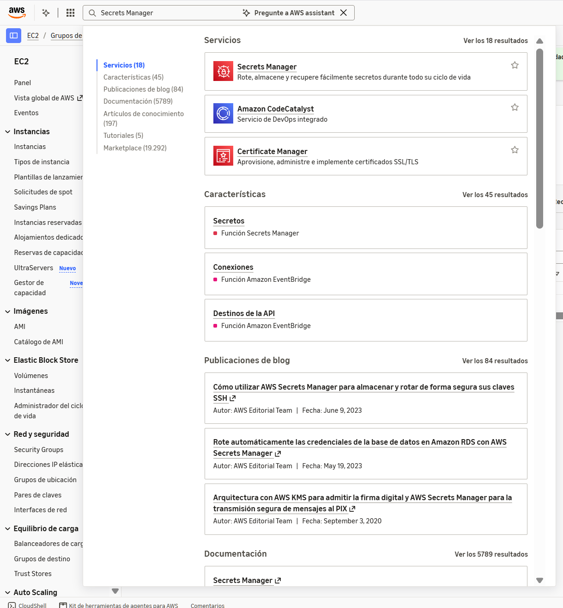

3. En el menú lateral izquierdo, haz clic en **Secretos** y verifica que se hayan creado los **7 secretos** de la aplicación (`/cafe/dbPassword`, `/cafe/dbUser`, `/cafe/dbName`, `/cafe/dbUrl`, `/cafe/currency`, `/cafe/timeZone` y `/cafe/showServerInfo`).

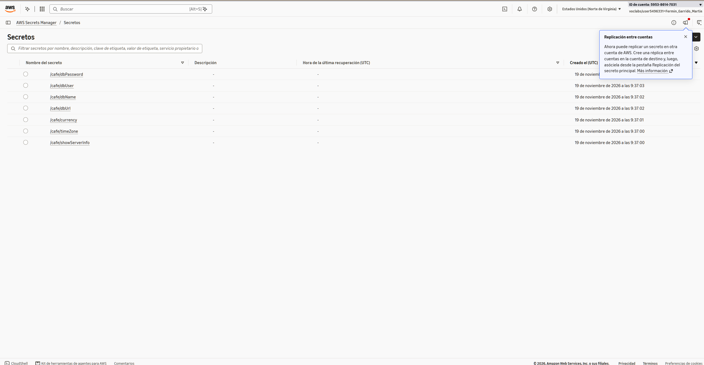

4. Haz clic sobre **`/cafe/dbPassword`**, baja hasta **Valor del secreto**, pulsa **Recuperar valor del secreto** y copia la contraseña obtenida (**`Lab123#`**).

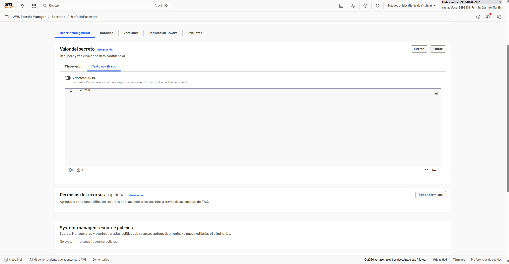

#### Paso 3: Inicializar la base de datos `cafe_db` y comprobar las tablas
1. De vuelta en la terminal Bash de VS Code, ejecuta los scripts de inicialización de la base de datos y conéctate al cliente MySQL como `admin`:

```bash
cd ~/environment/db/
./set-root-password.sh
./create-db.sh
mysql -u admin -p
```

Cuando solicite `Enter password:`, introduce la contraseña copiada de Secrets Manager (`Lab123#`) y pulsa **Intro** (no aparecerán caracteres al escribirla).

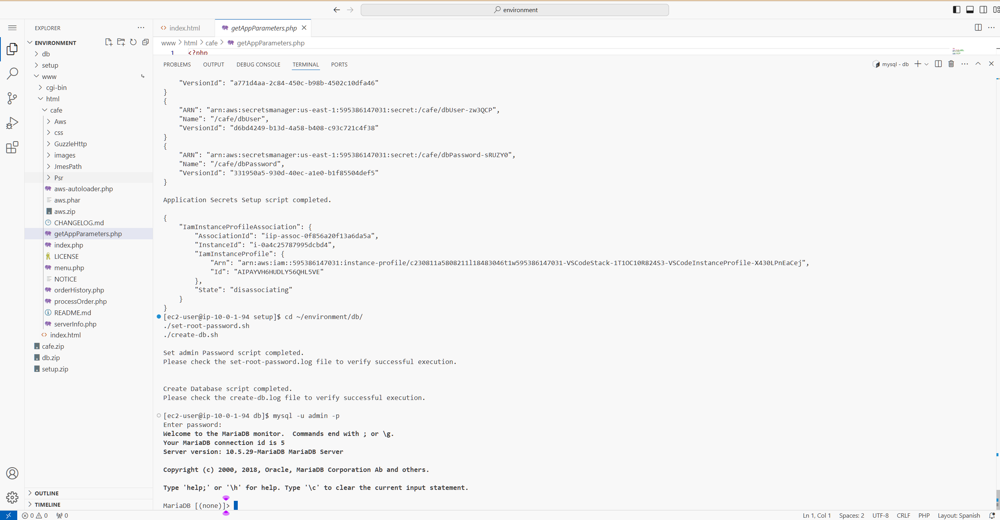

2. Dentro del prompt `MariaDB [(none)]>`, ejecuta las siguientes sentencias SQL para verificar que la base de datos `cafe_db`, sus 4 tablas (`order`, `order_item`, `product`, `product_group`) y los 9 productos del menú se han cargado correctamente:

```sql
show databases;
use cafe_db;
show tables;
select * from product;
exit;
```

> **💡 Nota:** Al pegar el bloque, si el cursor se detiene justo después de `exit;`, pulsa **Intro** una vez más para cerrar la sesión de MariaDB y volver al prompt normal de Bash.

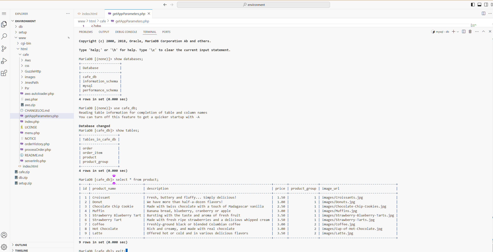

#### Paso 4: Configurar la zona horaria en PHP y diagnosticar el fallo del Desafío 2
1. Ya de vuelta en la terminal Bash normal, configura la zona horaria en `/etc/php.ini` y reinicia Apache:

```bash
sudo sed -i "2i date.timezone = \"America/New_York\" " /etc/php.ini
sudo service httpd restart
```

2. Abre en una nueva pestaña `http://54.160.23.31:8000/cafe` *(con tu IPv4 pública)*.
3. Verás que la página principal carga correctamente el HTML y las imágenes estáticas:

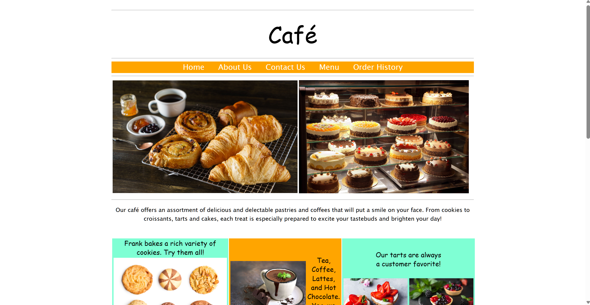


#### Paso 5: Resolución del Desafío 2 — Asignar el rol de IAM `CafeRole` a la instancia
1. **Diagnóstico del problema:** Aunque la portada estática carga bien, al hacer clic en la pestaña **Menu** la página aparece completamente en blanco debajo de la barra de navegación. Esto sucede porque el script `set-app-parameters.sh` desasoció el rol de IAM de la instancia, dejando a PHP sin permisos para leer las credenciales de la base de datos desde **AWS Secrets Manager**.

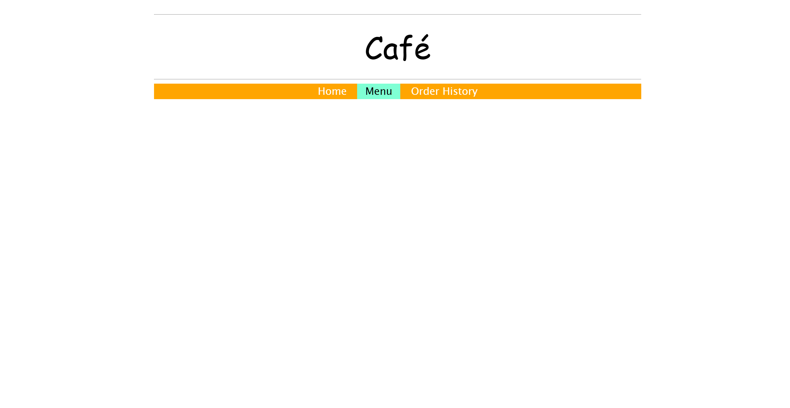

2. **Inspección del rol `CafeRole` en IAM:**
   * En la Consola de AWS, busca el servicio **IAM**, entra en **Roles** (menú izquierdo) y selecciona **`CafeRole`**.
   * En la pestaña **Permisos** verás dos políticas personalizadas de tipo *Cliente insertado*: **`importkey`** y **`root`**. *(Si despliegas el icono `+` junto a `root`, podrás ver los permisos que permiten a la instancia acceder a Secrets Manager y a otros servicios necesarios para la aplicación).*

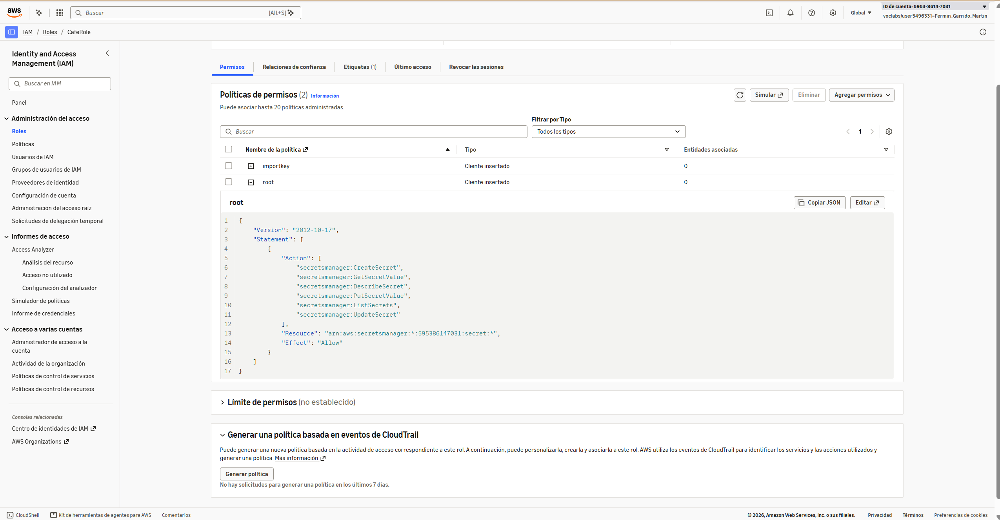

3. **Asociar `CafeRole` a la instancia `Lab IDE`:**
   * Ve a **EC2 > Instancias** y marca la casilla de **`Lab IDE`**.
   * En el menú superior derecho, selecciona **Acciones > Seguridad > Modificar rol de IAM**.
   * En el desplegable **Rol de IAM**, selecciona **`CafeRole`** y pulsa **Actualizar rol de IAM**.
   * Aparecerá una barra verde superior confirmando: *`CafeRole se ha asociado correctamente a la instancia i-0a4c25787995dcbd4`*.

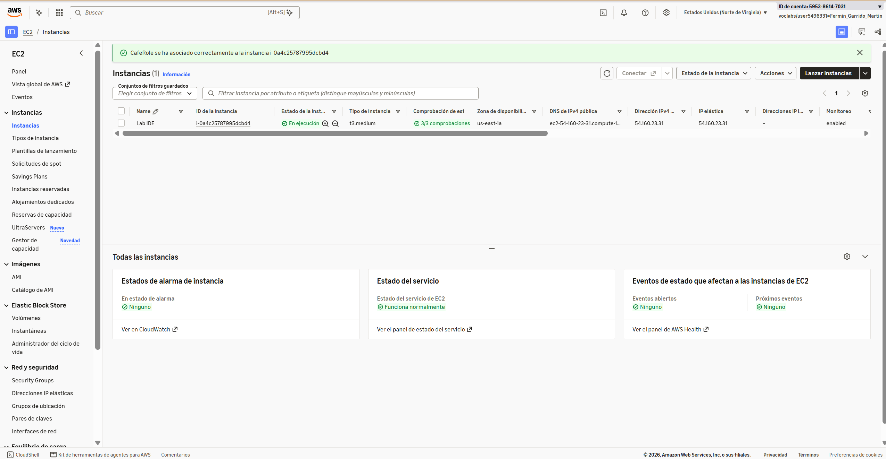

---

<a id="tarea-5"></a>
### Tarea 5: Probar la aplicación web

**Objetivo:** Comprobar que la aplicación lee los productos desde MariaDB usando los secretos de Secrets Manager y registra pedidos reales en la base de datos.

1. Vuelve a la pestaña del navegador con `http://54.160.23.31:8000/cafe` y haz clic en **Menu** (o recarga con `F5`). Ahora se muestran todos los productos, imágenes y precios de la cafetería.

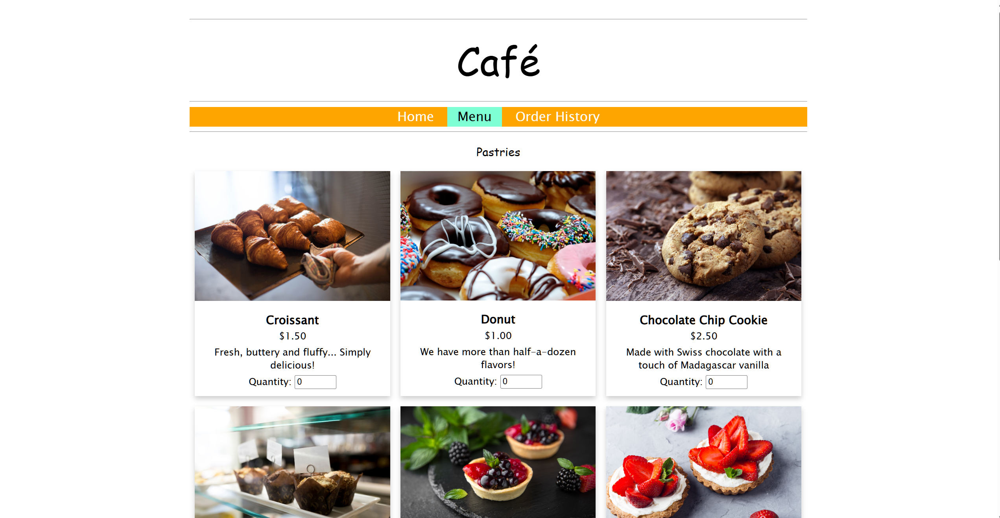

2. **Realizar dos pedidos de prueba:**
   * Selecciona la cantidad de un producto (por ejemplo, `1` unidad de *Hot Chocolate*), desplázate hasta el final y haz clic en **Submit Order**. Aparecerá la pantalla de confirmación (*Order Confirmation*).
   * Regresa a **Menu**, pide un segundo artículo distinto (por ejemplo, `1` unidad de *Coffee*) y vuelve a pulsar **Submit Order**.

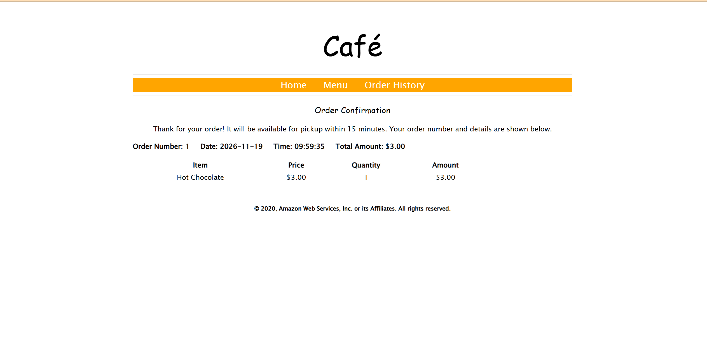

3. Haz clic en **Order History** en la barra superior para verificar que ambos pedidos (`Order Number: 1` y `Order Number: 2`) han quedado guardados en la base de datos `cafe_db`.

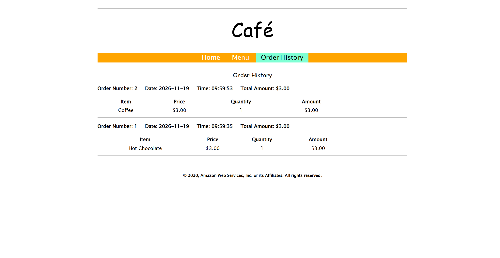

[⬆️ Volver al índice](#inicio)


---

<a id="desafio-3"></a>
## 3. Desafío 3: Crear entornos de desarrollo y producción en distintas regiones de AWS

<a id="tarea-6"></a>
### Tarea 6: Crear una AMI, responder Preguntas 5 a 7 y desplegar en Oregón (`us-west-2`)

**Objetivo:** Preparar la instancia actual (entorno de desarrollo en `us-east-1`), generar una **Amazon Machine Image (AMI)** llamada `CafeServer`, copiarla a la región **Oregón (`us-west-2`)** y desplegar allí la instancia de producción `ProdCafeServer` junto con sus secretos en Secrets Manager.

#### Paso 1: Configurar el `hostname` estático y crear un nuevo par de claves SSH
Antes de capturar la imagen de la instancia, ejecuta los siguientes comandos en la terminal Bash de VS Code desde `~/environment` *(cuando `ssh-keygen` solicite una frase de contraseña, pulsa **Intro** dos veces para dejarla vacía)*:

```bash
cd ~/environment
sudo hostname cafeserver
ssh-keygen -t rsa -f ~/.ssh/id_rsa
cat ~/.ssh/id_rsa.pub >> ~/.ssh/authorized_keys
```

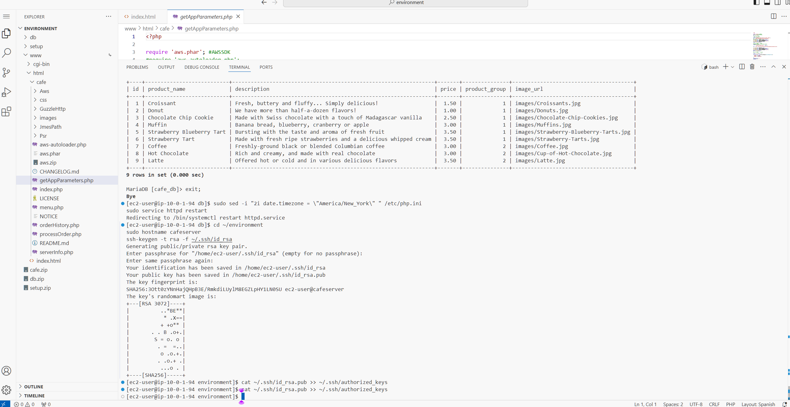

#### Paso 2: Abrir el asistente de creación de imagen (AMI)
1. En la Consola de AWS (región **Norte de Virginia / `us-east-1`**), ve a **EC2 > Instancias** y selecciona **`Lab IDE`**.
2. En el menú superior derecho, selecciona **Acciones > Imagen y plantillas > Crear imagen**.

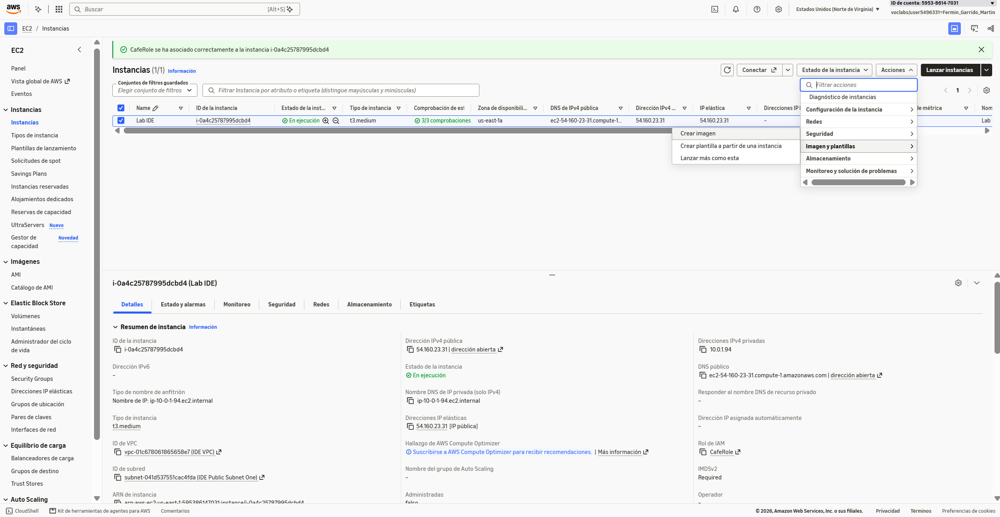

3. Antes de pulsar en crear, revisa los controles disponibles en la pantalla **Crear imagen** (la casilla **Reiniciar instancia**, la tabla **Volúmenes de instancia** y el botón **Agregar volumen**), ya que nos permiten responder las preguntas 5, 6 y 7 del cuestionario:

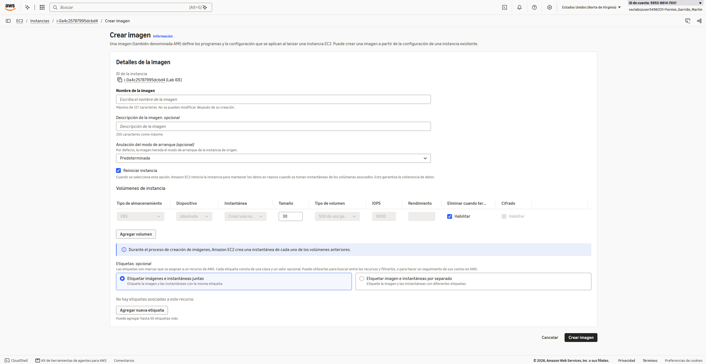

#### Paso 3: Preguntas sobre las AMI (Cuestionario: Preguntas 5 a 7)
Regresa a la pestaña del cuestionario, selecciona cada respuesta y pulsa su botón **Submit / enviar**:

| Nº | Pregunta | Respuesta correcta | Comprobación en la pantalla Crear imagen |
| :--- | :--- | :--- | :--- |
| **5** | Cuando se crea una AMI a partir de una instancia, ¿se reiniciará la instancia? | **Tienes la opción de *no* reiniciar, pero por defecto se reiniciará.** *(En inglés: You have the option not to reboot, but by default it will reboot.)* | La casilla **Reiniciar instancia** viene marcada por defecto para garantizar la coherencia de los datos, pero el usuario puede desmarcarla. |
| **6** | ¿De qué maneras se pueden modificar las propiedades del volumen raíz al crear una AMI a partir de una instancia? | **Puedes editar el tamaño y la configuración de "eliminar al finalizar", pero no el tipo de volumen.** *(En inglés: You can edit the size and the "delete on termination" setting, but not the volume type.)* | En la fila `/dev/xvda`, solo el campo **Tamaño** (`30`) y la casilla **Eliminar cuando termine** (`Habilitar`) están activos; **Tipo de volumen** está deshabilitado en gris. |
| **7** | ¿Se pueden agregar más volúmenes a una AMI creada a partir de una instancia que solo tiene un volumen? | **Sí** *(En inglés: Yes)* | Justo debajo de la tabla del volumen raíz está disponible y habilitado el botón **Agregar volumen**. |

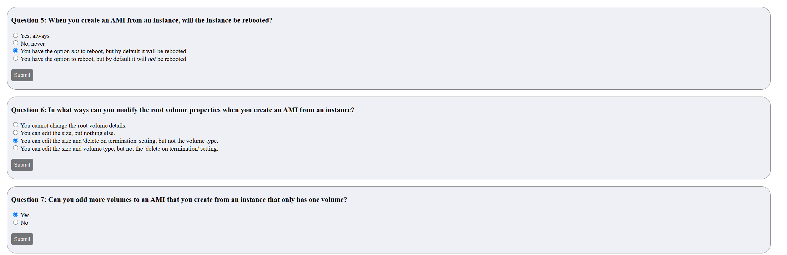

#### Paso 4: Crear la AMI `CafeServer` en Norte de Virginia (`us-east-1`)
1. En el formulario **Crear imagen**, escribe **`CafeServer`** en el campo **Nombre de la imagen** y pulsa **Crear imagen**.
2. Aparecerá una notificación verde indicando el ID de la AMI en proceso (en esta sesión: **`ami-00931e1cee1e79c61`**).

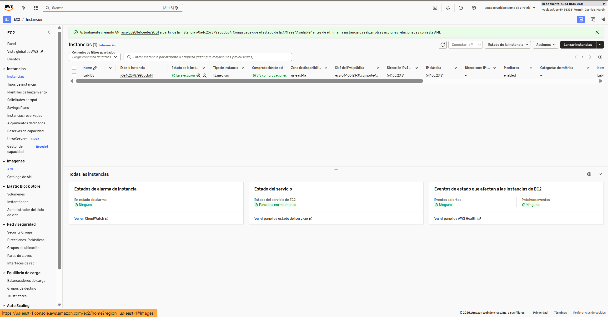

3. En el menú lateral izquierdo de EC2, entra en **Imágenes > AMI**. Inicialmente aparecerá en estado **Pendiente**:

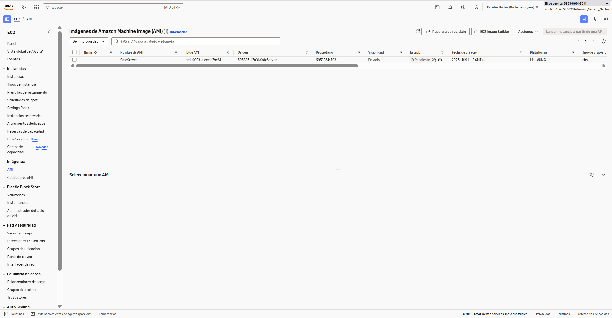

4. Tras esperar unos 2 minutos y actualizar la tabla, el estado cambiará a **Disponible**:

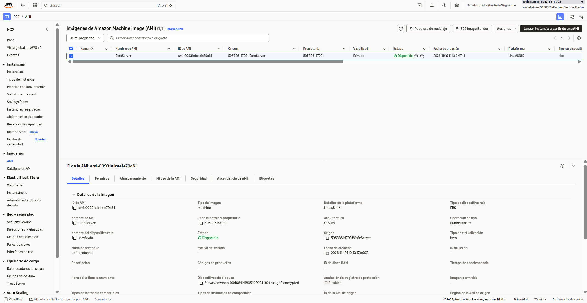


#### Paso 5: Resolución del Desafío 3 — Copiar la AMI a Oregón (`us-west-2`)
Las AMI son recursos **regionales**, por lo que una imagen creada en Norte de Virginia no aparece automáticamente en Oregón. Para desplegar el entorno de producción en otra región debemos copiarla:

1. En **EC2 > Imágenes > AMI** (aún en **Norte de Virginia / `us-east-1`**), selecciona **`CafeServer`**.
2. Haz clic en **Acciones > Copiar AMI**.
3. En **Región de destino**, selecciona **EE. UU. Oeste (Oregón) `us-west-2`**, mantén el nombre `CafeServer` y pulsa **Copiar AMI**.

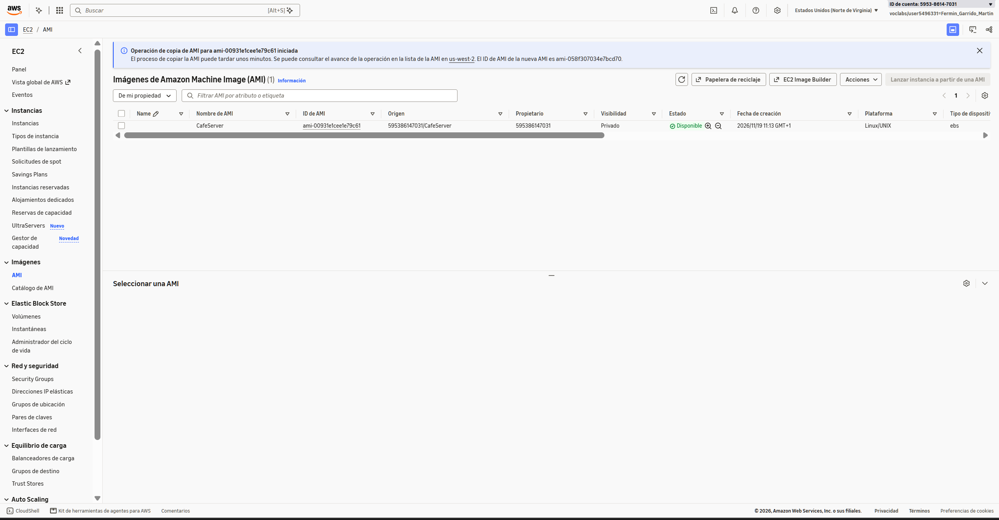

4. Cambia la región de la Consola de AWS (esquina superior derecha) a **Estados Unidos (Oregón)** y entra en **EC2 > Imágenes > AMI**.
5. Espera entre 3 y 5 minutos hasta que la AMI copiada (en esta sesión: **`ami-058f307034e7bcd70`**) muestre el estado **Disponible**.

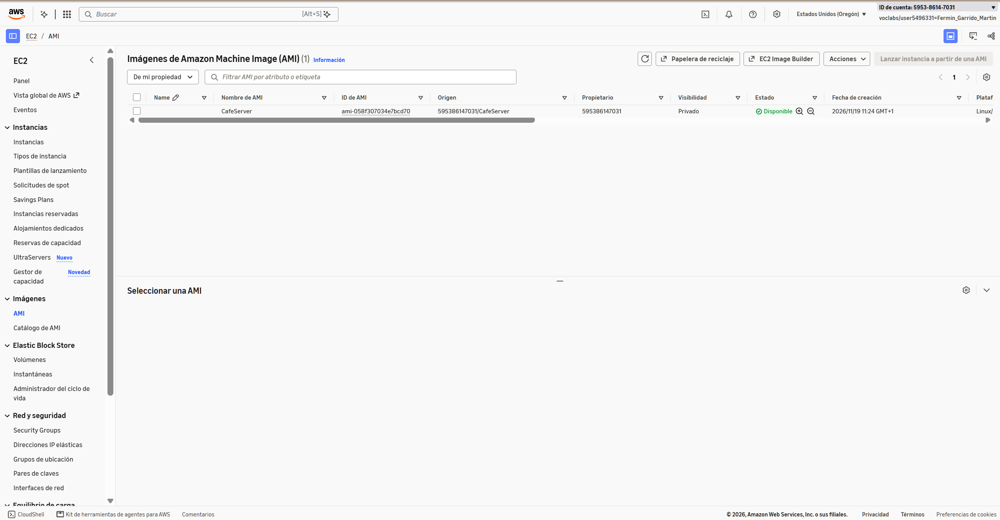

#### Paso 6: Lanzar la instancia de producción `ProdCafeServer` en Oregón
Con **`CafeServer`** seleccionada en **Oregón (`us-west-2`)**, pulsa **Lanzar instancia a partir de una AMI** y configura los siguientes parámetros:

1. **Nombre, tipo de instancia y par de claves:**
   * **Nombre:** `ProdCafeServer` *(etiqueta `Name = ProdCafeServer`)*.
   * **Tipo de instancia:** `t2.small`.
   * **Par de claves (inicio de sesión):** `Continuar sin un par de claves (no recomendado)` *(la clave SSH generada en el Paso 1 ya está integrada en la AMI)*.

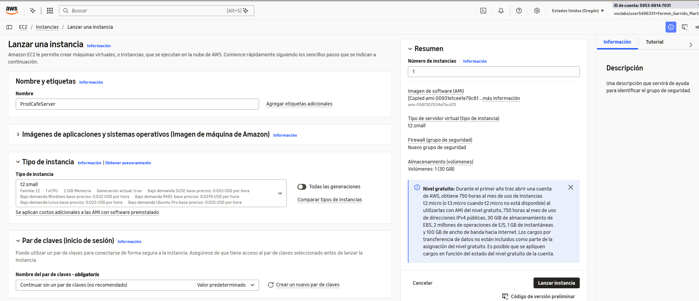

2. **Configuraciones de red (pulsa Editar):**
   * **VPC:** `Lab VPC Region 2`
   * **Subred:** `Public Subnet`
   * **Asignación automática de IP pública:** `Habilitar`
   * **Firewall (grupos de seguridad):** *Crear un grupo de seguridad* con nombre **`cafeSG`** y dos reglas de entrada:
     * **Regla 1:** `SSH` (TCP `22`) — Origen: `Cualquier lugar` (`0.0.0.0/0`)
     * **Regla 2:** `TCP personalizado` (puerto `8000`) — Origen: `Cualquier lugar` (`0.0.0.0/0`)

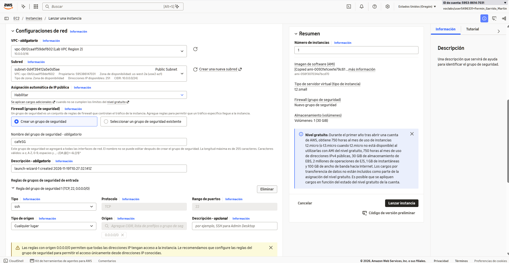

3. **Detalles avanzados:**
   * En **Perfil de instancia de IAM**, selecciona **`CafeRole`**.
   * Haz clic en **Lanzar instancia**.

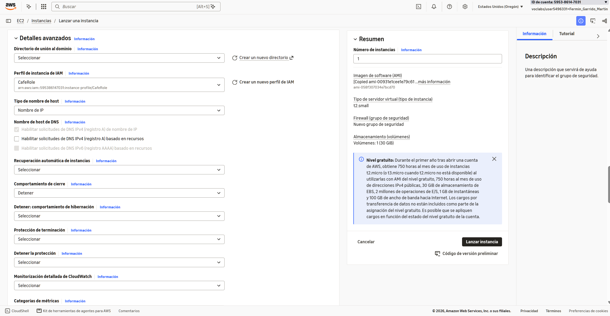

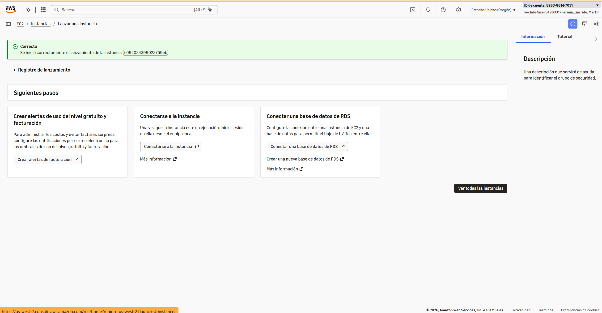

4. Entra en **EC2 > Instancias** (en Oregón), selecciona **`ProdCafeServer`** y anota sus datos de red públicos *(en esta sesión)*:
   * **Dirección IPv4 pública:** `54.187.196.4`
   * **DNS público de IPv4:** `ec2-54-187-196-4.us-west-2.compute.amazonaws.com`

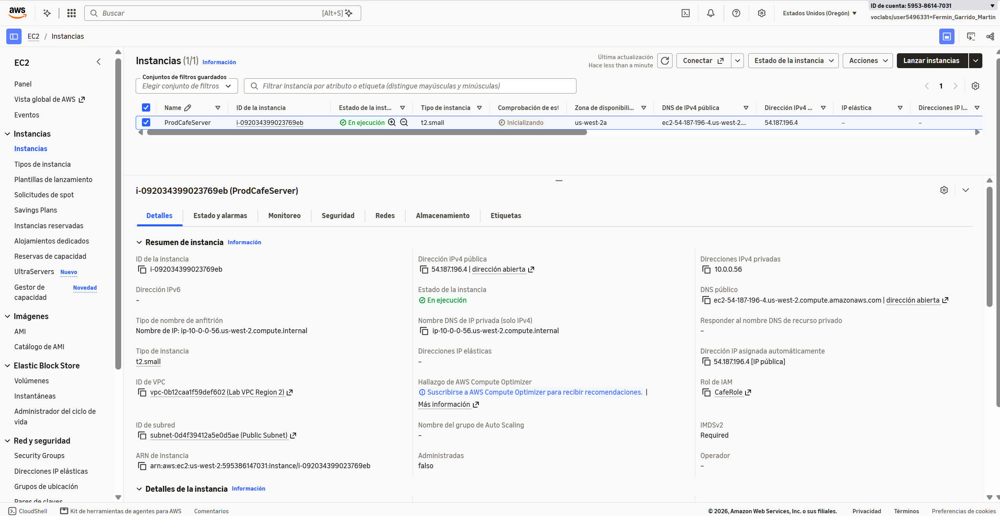

#### Paso 7: Crear los 7 secretos en Secrets Manager de Oregón (`us-west-2`)
1. Vuelve a la pestaña del **IDE de VS Code** *(si se desconectó al reiniciarse la instancia durante la creación de la AMI, recarga la pestaña con `F5`)*.
2. Abre el archivo **`setup/set-app-parameters.sh`**. Puedes sustituir todo su contenido por el siguiente bloque, **asegurándote de reemplazar el valor de `publicDNS` por el DNS público real de tu instancia `ProdCafeServer`**:

```bash
#!/bin/bash
#
# Script to set the parameters for the cafe application in the Parameter Store.
#
echo
echo "Setting the default AWS region..."
TOKEN=$(curl -X PUT "[http://169.254.169.254/latest/api/token](http://169.254.169.254/latest/api/token)" -H "X-aws-ec2-metadata-token-ttl-seconds: 21600")

az=$(curl -H "X-aws-ec2-metadata-token: $TOKEN" -v [http://169.254.169.254/latest/meta-data/placement/availability-zone](http://169.254.169.254/latest/meta-data/placement/availability-zone))
region="us-west-2"
export AWS_DEFAULT_REGION=$region
echo "Region =" $AWS_DEFAULT_REGION
#
# Set the application parameter values.
#
# IMPORTANTE: Sustituir por el DNS público IPv4 real de TU instancia ProdCafeServer en Oregón
publicDNS="ec2-54-187-196-4.us-west-2.compute.amazonaws.com"
echo "Public DNS =" $publicDNS

echo "Setting the application parameter values in the Secrets Manager..."
aws secretsmanager create-secret --name "/cafe/showServerInfo" --secret-string "false"
aws secretsmanager create-secret --name "/cafe/timeZone" --secret-string "America/New_York"
aws secretsmanager create-secret --name "/cafe/currency" --secret-string "$"
aws secretsmanager create-secret --name "/cafe/dbUrl" --secret-string $publicDNS
aws secretsmanager create-secret --name "/cafe/dbName" --secret-string "cafe_db"
aws secretsmanager create-secret --name "/cafe/dbUser" --secret-string "admin"
aws secretsmanager create-secret --name "/cafe/dbPassword" --secret-string "Lab123#"

echo
echo "Application Secrets Setup script completed."
echo
#following command removes profile attached to the instance so that user can perfom step33, running cafe server as a challenge
aws ec2 disassociate-iam-instance-profile --association-id $(aws ec2 describe-iam-instance-profile-associations --query "IamInstanceProfileAssociations[?contains(IamInstanceProfile.Arn, 'VSCodeInstanceProfile')].AssociationId" --output text)
```

3. Guarda el archivo (`Ctrl + S`) y ejecútalo en la terminal Bash de VS Code:

```bash
cd ~/environment/setup/
./set-app-parameters.sh
```

> **💡 Dos notas importantes al ejecutar este script por segunda vez:**
> * Es totalmente normal que la última línea muestre un error `ParamValidation: argument --association-id: expected one argument`, ya que intenta desasociar el perfil `VSCodeInstanceProfile` que ya reemplazamos antes por `CafeRole`. Lo importante es ver los **7 bloques JSON en `us-west-2`** y el mensaje `Application Secrets Setup script completed.`.
> * Si por error ejecutaste el script con un `publicDNS` incorrecto y necesitas corregirlo sin recrear todos los secretos, basta con ejecutar este comando en la terminal:
>   ```bash
>   aws secretsmanager put-secret-value --region us-west-2 --secret-id "/cafe/dbUrl" --secret-string "<TU-PUBLIC-DNS-REAL>"
>   ```

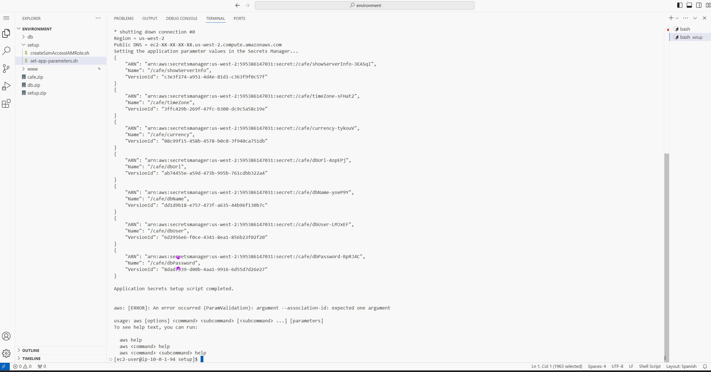

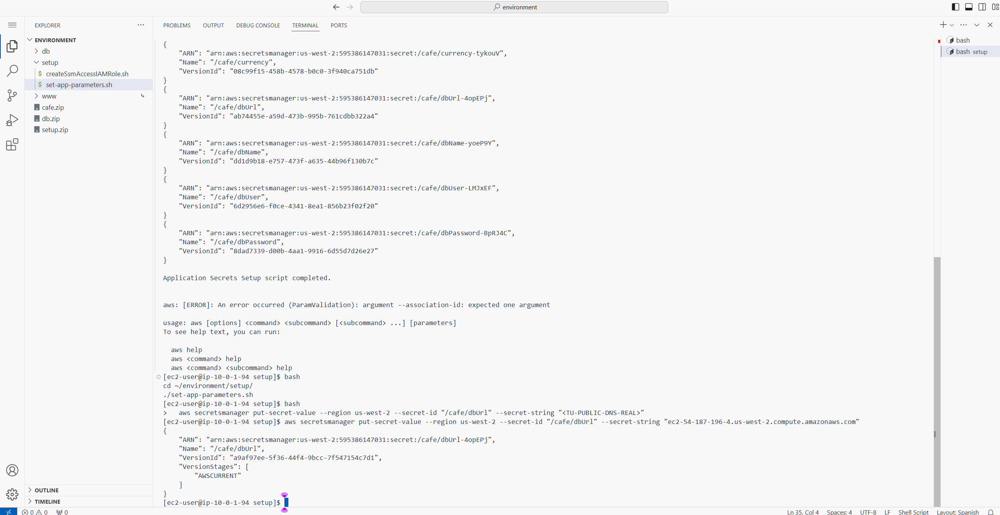

---

<a id="tarea-7"></a>
### Tarea 7: Verificar la nueva instancia de producción y enviar el laboratorio

**Objetivo:** Confirmar que la instancia `ProdCafeServer` desplegada en **Oregón (`us-west-2`)** sirve la página de prueba, carga el menú desde su base de datos local usando los secretos regionales de Oregón y registra nuevos pedidos correctamente.

#### Paso 1: Revisar el grupo de seguridad `cafeSG` en Oregón
Antes de probar la web en el navegador, selecciona **`ProdCafeServer`** en **EC2 > Instancias** (región **Oregón**) y abre la pestaña inferior **Seguridad**:
* Verifica que el **Rol de IAM** sea **`CafeRole`**.
* Verifica en **Reglas de entrada** de **`cafeSG`** que estén abiertos tanto el puerto **TCP `22`** (SSH) como el puerto **TCP `8000`** desde `0.0.0.0/0`. *(Si al lanzar la instancia olvidaste añadir la segunda regla del puerto `8000`, haz clic en `cafeSG > Editar reglas de entrada > Agregar regla` y añade `TCP personalizado` puerto `8000` con origen `0.0.0.0/0` antes de continuar).*

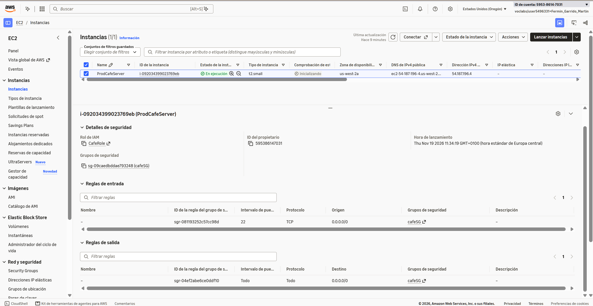

#### Paso 2: Probar el servidor web y la aplicación de la cafetería en producción
1. Abre una pestaña nueva en el navegador y accede a `http://54.187.196.4:8000` *(usando la IPv4 pública de tu `ProdCafeServer`)*. Debe mostrarse el mensaje **`Hello from the café web server!`**.

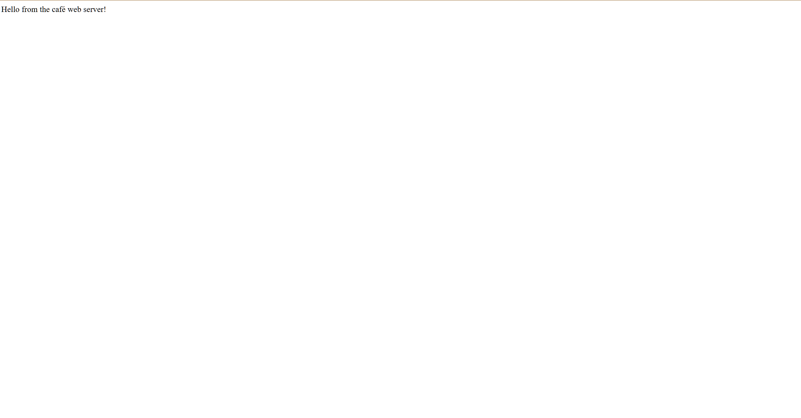

2. Accede ahora a `http://54.187.196.4:8000/cafe/`, entra en **Menu** y realiza uno o dos pedidos de prueba (por ejemplo, un *Latte* y un *Hot Chocolate*).
3. Entra en **Order History**. Comprobarás que aparecen tanto los **pedidos 1 y 2** (que venían guardados en la base de datos dentro de la AMI copiada desde Virginia) como los **nuevos pedidos 3 y 4** recién registrados en el servidor de producción de Oregón.

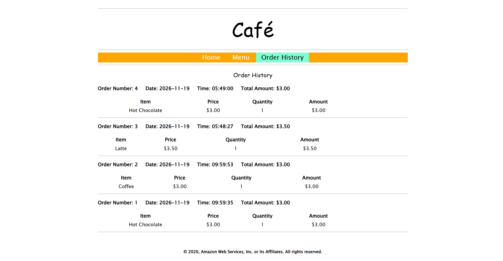

> **💡 Solución de problemas opcional (acceso SSH a producción):** Si necesitaras conectarte por SSH a `ProdCafeServer` desde la terminal del IDE de VS Code en `us-east-1`, puedes usar la clave generada en la Tarea 6:
> ```bash
> ssh -i ~/.ssh/id_rsa ec2-user@54.187.196.4
> ```

#### Paso 3: Enviar el laboratorio y comprobar la calificación (`30/30`)
1. Asegúrate de haber pulsado el botón **`Submit`** debajo de cada una de las **7 preguntas** en la pestaña del cuestionario.
2. En la pestaña principal del laboratorio de AWS Academy, pulsa el botón superior **`Submit`** y confirma con **`Yes`**.
3. Espera 1 o 2 minutos y haz clic en **`Grades`** (o **`Submission Report`**) para comprobar el desglose completo de puntos (**`Total score: 30/30`**).

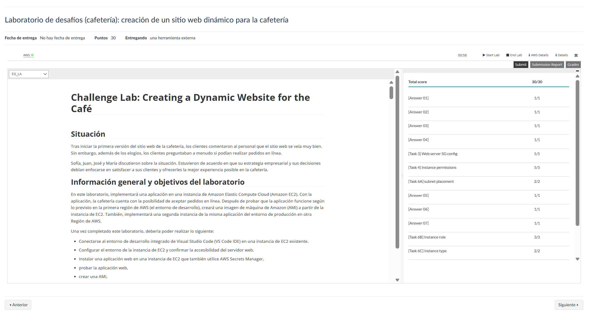

4. Por último, recuerda pulsar **`End Lab`** y confirmar con **`Yes`** en la barra superior de AWS Academy para cerrar y liberar los recursos del laboratorio.

[⬆️ Volver al índice](#inicio)